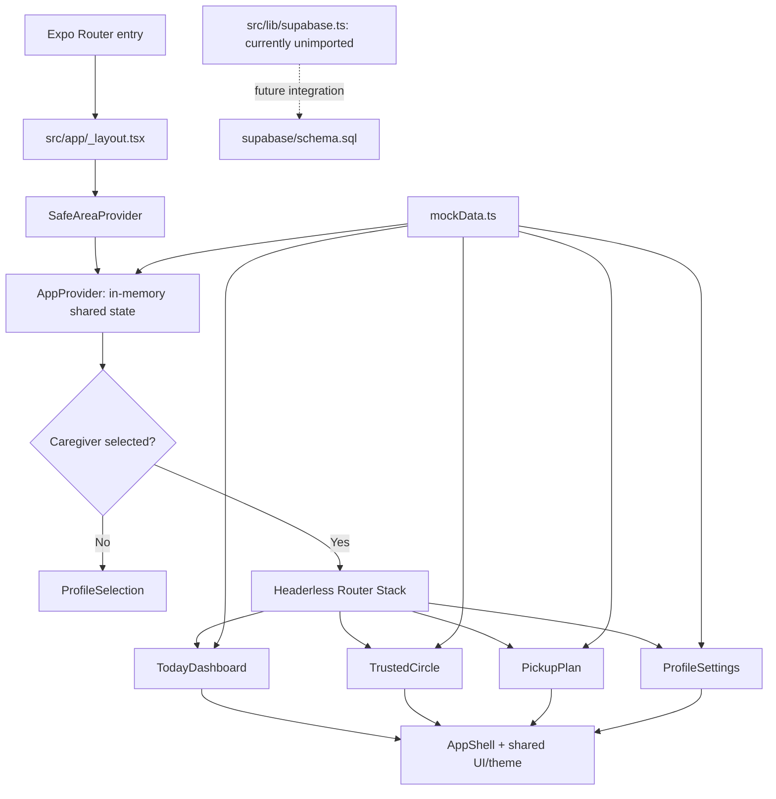

# SafeNest Project Update and Feature Implementation Report

**Assessment date:** 18 October 2026 (Asia/Kuala_Lumpur)  
**Assessed revision:** `909cb42` — `update new queries`  
**Working branch:** `master`  
**Assessment type:** Read-only repository, history, dependency, and static implementation review; only this report was created.

## 1. Assessment scope and interpretation

The review covered the complete first-party workspace: all 74 Git-tracked files, hidden configuration, all 37 TypeScript/TSX source files, the 6,317-line HTML design reference, package manifests and lockfile, SQL schema, documentation, and asset references. It also inventoried ignored local Expo artifacts and the installed dependency tree. Git metadata, branches, history, additions, deletions, and differences were examined across all locally available refs, rather than just the latest commit.

Third-party `node_modules` was assessed through installed package metadata and dependency diagnostics, not by auditing every vendor source file. Binary images were inventoried and their code/configuration references checked; this was not a visual review of every image. Generated Expo route types and local CLI logs were considered supporting artifacts, not authoritative proof that the current revision runs. No credentials, environment values, device identifiers, or personal Git author contact details are reproduced here.

### Evidence and status terminology

| Classification | Meaning in this report |
| --- | --- |
| Implemented demo | A reachable frontend implementation and its event/state logic exist; live device behavior remains unverified unless specifically stated. |
| Partial | Some implementation exists, but integration, lifecycle behavior, or required scope is missing. |
| Scaffold / unverified | Infrastructure source exists, but use, deployment, or execution is not established. |
| Reference-only / not implemented | Present in the HTML prototype or schema intent, but absent from the native application path. |
| Verified check | A command or static inspection was actually performed, with its result recorded. |
| Static finding | Follows from current source/data flow; not a reproduced device test. |

No screen is certified as production-ready by this review. Package-resolution failures prevent a clean TypeScript check, and no Expo Go session, emulator session, browser interaction test, database deployment, or remote service test was performed.

## 2. Current project overview

SafeNest is a family school-pickup coordination prototype. A user selects one of two fictional caregiver profiles, then explores Today, Trusted Circle, Pickup Plan, and Settings. The native UI demonstrates collector status, an illustrated map, dismissal schedules, trusted-helper approval, backup collection requests, simulated teacher verification, appearance preferences, and local profile management.

The application is currently a **frontend demonstration with a disconnected backend scaffold**. The latest three commits add Supabase dependencies, a client module, and a substantial PostgreSQL schema. None of the route or component files imports that client. Consequently, current screen actions do not authenticate users, query the database, write plans to Supabase, send invitations, track locations, or deliver notifications.

`AGENTS.md` still specifies frontend-first development and explicitly defers Supabase/authentication/live services. The new backend files represent preparatory work beyond that documented phase, while remaining outside the running frontend dependency graph. The team should reconcile the intended phase before activating integration.

### 2.1 Technology and architecture

| Area | Actual implementation |
| --- | --- |
| Application entry | `package.json` uses `expo-router/entry`. |
| Runtime/UI | Expo `~57.0.28`, React `19.2.3`, React Native `0.86.3`; React DOM and React Native Web support a web target. |
| Routing | Expo Router `~57.0.27`; four thin route components under `src/app`, a headerless `Stack`, and a custom bottom navigation bar. |
| Language | TypeScript `~6.0.3`, strict mode, Expo base configuration and `@/*` / `@/assets/*` aliases. |
| Styling | Native inline styles and `StyleSheet`, shared theme tokens and visual primitives; no active CSS styling framework. |
| Motion | React Native Animated plus Reanimated `4.5.1` / Worklets `0.10.1`; CSS-style animation declarations in native components. |
| Graphics | `react-native-svg` for icons, gradients, time-wheel fades, and the illustrated map. No mapping SDK. |
| Device behavior | Safe-area handling, optional selection haptics, and gallery photo selection through Expo Image Picker. |
| Business state | React context, screen-local `useState`, and three small `useSyncExternalStore` module stores. |
| Backend preparation | Supabase JS, AsyncStorage session configuration, URL polyfill, and PostgreSQL schema/RLS/RPC definitions. Unused by screens. |
| Packaging | Portrait app, `safenest` URL scheme, automatic system appearance, static web output, generated native folders ignored. |
| Validation/tooling | TypeScript available; no test runner, test files, CI workflow, or checked-in ESLint configuration found. |

### 2.2 Composition and data flow

`RootNavigator` renders `ProfileSelection` whenever `selectedCaregiver` is null. Selecting a mock caregiver sets context and mounts the stack. Each route delegates to its screen-specific component. `AppShell` supplies scrolling, safe-area padding, titles, custom tabs, pending-count badges, haptics, and animations. Tab presses use `router.replace`, so screen-local state must not be assumed to survive tab changes.

## 3. Complete feature inventory and current status

### 3.1 Entry, navigation, accessibility, and shared presentation

| Feature | Behavior and implementation evidence | Status / limits |
| --- | --- | --- |
| Caregiver selection | `ProfileSelection.tsx` renders mock caregiver cards and calls `selectCaregiver`; `_layout.tsx` gates the stack. | Implemented demo. No credential entry or identity verification. |
| Four-screen navigation | `src/app/index.tsx`, `circle.tsx`, `plan.tsx`, `settings.tsx`; `AppShell.tsx` maps Today/Circle/Plan/Settings to route paths. | Implemented; runtime transitions unverified. |
| Active tab feedback | Animated teal indicator, selected tab color/scale, optional haptics and accessible tab roles in `AppShell.tsx`. | Implemented; haptics dependency missing locally. |
| Pending approval badge | Shared pending helpers plus Circle-local pending count; only shown when selected caregiver has `isAdmin`. | Partial: local count clears when Circle unmounts; badge permission does not restrict approval actions. |
| Light, dark, system themes | `AppContext.tsx` resolves `useColorScheme`; `theme.ts` supplies screen, card, semantic, map, avatar, and scrim colors. | Implemented session state; no saved preferences. |
| Four text sizes | Scale values `0.92`, `1`, `1.15`, `1.3`; `T`, inputs, tab labels and responsive facts use theme values. | Implemented; not every fixed-size map/badge label scales. |
| Four font choices | Settings offers Serif, Work Sans, Antic, Balloon Bold; `fontFace` chooses platform families and clamps weights. | Implemented platform substitutes, not bundled exact named fonts. |
| Responsive/safe-area layouts | Wrapping rows, scroll views, keyboard avoidance in sheets, short-screen time wheels, dynamic Today map height and fact stacking. | Present in code; small-screen, keyboard and large-text behavior untested. |
| Accessible controls | Labels, roles, selected/checked states, live-region notices, modal semantics, minimum touch sizes in many controls. | Partial assurance only; no screen-reader audit. |
| Reduced motion | `anim`, map effects, sheets and several primitives honor Reanimated reduced-motion state. | Partial: press scaling and several AppShell timing animations still run. |
| Shared overlays | `Sheet.tsx` supports scrim/close/back handling, opening/closing animations, scrolling content, optional pinned footer. | Implemented; no proven focus restoration/trapping on web. |

### 3.2 Today

Primary evidence: `src/components/today/TodayDashboard.tsx`, `DemoControls.tsx`, `shared/demoScenario.ts`, `shared/MapView.tsx`.

| Feature | How it works | Status / limits |
| --- | --- | --- |
| Greeting and child dismissal chip | Device hour selects greeting; selected caregiver name and shared schedule determine text. | Implemented demo; device date is not a school calendar. |
| Pickup summary | Combines fixed mock collector/status, optional demo scenario, accepted shared backup helper, and temporary dismissal. Displays state, ETA, explanatory copy and next step. | Implemented demo; no actual ETA computation or live feed. |
| Status variants | Planned/on-track/late/covered/arrived branches exist; on-road and at-school derive from place. | Five scenarios are selectable; planned/covered enum states have no dedicated scenario controls. Accepted backup derives coverage. |
| Demo controls | Normal day, On the way, Waiting at school, Running late, Pickup complete. `demoScenario.ts` preserves selection in module memory. | Implemented; affects Today only. |
| Map and people | Fixed coordinates for family and active shared helpers; collector moves among office/road/school positions. | Illustrated simulation, not GPS. |
| Full map | `FullMap` opens a modal with safe-area overlays and a contain-style map fit. | Implemented; no pan, zoom or real navigation. |
| Completed-route animation | `MapView` animates an SVG route and moving car dot for 5.2 seconds, then shows stopped text. | Visual simulation; route is not calculated. |
| Backup shortcut | Picks the first active shared helper and calls `requestBackupPickup`. Disabled when none are active or a request is already pending/accepted. | Shared with Plan; ignores Circle availability and may choose the already scheduled collector. |
| Backup/time-change notice | Prioritizes shared backup notices, then mock schedule change, then temporary dismissal notice. | Implemented. The optional `schedule.changedToday` fixture is unset in current mock data. |
| Plan/Circle shortcuts | Router links display child/school and active shared-helper count. | Implemented. Locally added Circle helpers are excluded. |

### 3.3 Trusted Circle

Primary evidence: `src/components/circle/TrustedCircle.tsx:32`, `shared/pendingBadge.ts`, `shared/profileEdits.ts`.

| Feature | How it works | Status / limits |
| --- | --- | --- |
| Family/helper directory | Combines fixed family data with shared and locally added helpers; separates pending from approved helpers. | Implemented demo. Rejected helpers disappear from visible lists. |
| Expandable person details | Shows phone, sample location label, relationship, availability, current-collector tag and actions. | Implemented. Collector tag always uses mock collector, even after Plan backup acceptance. |
| Approve/reject helper | Updates context for seeded helpers, screen state for locally added helpers. | Partial integration. No admin check on these actions. |
| Remove helper | Seeded helper becomes `rejected`; local helper is removed. Cleans local phone/availability/primary-contact entries and broadcast recipients. | Partial: no reconciliation with an existing shared backup request or scheduled collector. |
| Add helper | Name, integer age >= 0, relationship, optional phone; timestamp local ID; creates pending helper and simulated invitation notice. | Implemented local demo. No actual invite/link and no upper age or phone validation. |
| Own availability | Selected caregiver can toggle their own rendered row and set an end time via time wheel; other people are read-only. | Partial: local only; no expiry calculation; custom Settings accounts have no corresponding directory row. |
| Emergency contacts | Toggles primary flags and groups primary helpers under Emergency contacts. | Local presentation only; no notification priority or shared emergency-contact model. |
| Broadcast backup request | Selects a time, snapshots all approved locally available helpers, permits a simulated approval, and opens a confirmation sheet. | Separate local workflow; does not update Today/Plan request or collector. No decline/escalation path equivalent to prototype. |
| Pending tab count publication | Publishes number of locally pending helpers through external store and clears it on cleanup. | Works only while that Circle instance exists. |
| Edited caregiver phone lookup | Reads `useProfileEdits` for seeded caregiver phones. | Reader remains, but active Settings screen does not write that store. |

New helpers start unavailable. Availability controls are only offered for the selected account owner, while startup profiles are the two parents. Thus a newly invited helper cannot normally be made available in the current Circle flow, even after approval. It also never enters shared `trustedHelpers`, so Plan and Today cannot select it.

### 3.4 Pickup Plan

Primary evidence: `src/components/plan/PickupPlan.tsx:30–153`, `shared/AppContext.tsx:118–156`, `shared/TimeWheel.tsx`.

| Feature | How it works | Status / limits |
| --- | --- | --- |
| Current dismissal | Uses weekday schedule, replaced by matching temporary override. | Shared with Today; weekends are mapped to weekdays. |
| Weekly schedule editor | Opens weekday draft; time wheel selects minute-precision 12-hour time; saves via `updateWeekdayTime`. | Implemented shared session data for the single mock child. |
| Temporary dismissal | Saves `{weekday, time}` independently; reset restores regular schedule. | Partial: described as today-only but not date-bound or auto-expiring. |
| Input validation | Regex requires 1–12 hour, two-digit minutes and uppercase AM/PM; context also checks child ID and weekday 1–5. | Present; context silently ignores invalid regular updates. |
| Backup helper choice | Active shared helpers only; draft selection is distinct from stored request helper. | Implemented; no Circle availability filtering. |
| Request/answer/reset | Idle -> requested -> accepted/declined, with clear and ask-again actions. Existing pending request can be retargeted; resolved selection is locked until cleared. | Implemented demo. Responses are simulated buttons, not another user's answer. |
| Collector substitution | Accepted helper becomes Plan and Today collector. | Shared integration exists; Circle collector tag remains unchanged. |
| Teacher check | Uses collector avatar and fixed photo description; prepare -> awaitingTeacher -> approved/rejected, plus reset/retry. | Simulated only. No photo capture/upload or actual teacher authorization. |
| Verification ownership | Module record keyed by collector ID; `useLayoutEffect` and derived state prevent another collector's decision from being shown. | Partial lifecycle protection; not keyed by child/date/request and cannot observe away-and-back changes while Plan is unmounted. |
| Child/school details | Disclosure shows fixed child/class, school/address/teacher. | Implemented for mock child only. |
| Pickup explanation | Four explanatory steps generated from current collector/dismissal. | Implemented informational content. |

Teacher approval does not complete the pickup on Today. Conversely, Today can select the Pickup complete scenario without teacher approval. They are independent demonstrations, not one enforced pickup state machine.

### 3.5 Settings and profile

Primary evidence: `src/components/settings/ProfileSettings.tsx`, `SchoolPreferences.tsx`, `shared/theme.ts`.

| Feature | How it works | Status / limits |
| --- | --- | --- |
| Settings home/subpages | Profile card and grouped rows open Account, Appearance, Notifications, Family and school, Passkey & Security, Privacy; internal page state controls animated navigation. | Implemented demo; not separate Router URLs. |
| Edit account | Validates name/relationship, >=9 phone digits, email syntax; updates local account and selected caregiver context. | Partial propagation: greeting changes, Circle still reads mock name/phone or old edit store. |
| Add/switch account | Screen-local account array; timestamp IDs; local passwords; selecting updates context. | Demo only; arbitrary roles and no authentication. New accounts default non-admin. |
| Profile photo | Requests gallery permission, launches image picker with square editing, stores image URI locally. | Real device interaction; library missing locally, device behavior unverified; no upload/persistence. |
| Password display | Mask/reveal control for local demonstration password. | Not production credential handling. Do not enter real passwords. |
| Forgot-password flow | Simulated SMS/email channel, fixed demo PIN, >=8-character password and matching confirmation validation. | No message delivery or auth-provider password reset. PIN value intentionally omitted here. |
| Logout | Clears selected caregiver and local login flags. | Root gate unmounts routed screens, showing profile selector. Settings' own signed-out account list is bypassed. |
| Appearance | Shared theme, size and platform font presets; live preview. | Implemented session-wide presentation. |
| Push preference switches | Pickup reminder, helper availability, system alerts. Test action inserts dismissible in-app banner. | Simulated; toggles do not schedule notifications or gate the test button. |
| School preference switches | Pickup alerts, gate status, delay alerts in `SchoolPreferences`. | Local component state; remounting Notifications resets these independently of other preferences. |
| Child profiles | Lists initial mock child; Add child validates all fields, age 1–18 and teacher phone. | Settings-local only; no edit/delete/switch child support in pickup flows. |
| Teacher WhatsApp | Normalizes number (including Malaysian local prefix) and calls `Linking.openURL` with `https://wa.me/...`. | Real external link, not simulated delivery; no message content/teacher workflow integration. Not launched in review. |
| Circle summary | Counts mock caregivers/family and active shared helpers. | Excludes custom accounts and locally added Circle helpers. |
| Passkey/security | Toggle plus Device PIN, Face ID, Fingerprint selection. | Simulation only; no biometrics, key registration, storage or verification. |
| Privacy explanation | States memory-only preview behavior and simulated tracking/notifications. | Broadly reflects current data flow; gallery permission and WhatsApp external navigation are real actions. |

`AppearanceSettings.tsx` and `CaregiverProfileSection.tsx` remain in the repository but are not imported by the active route composition. Their functionality must not be counted as additional reachable Settings features. In particular, the older caregiver component writes `profileEdits`, while the current Settings component does not.

## 4. Design-reference comparison and evidence-supported future scope

`design_reference/SafeNest Pickup (2).html` is the sole available prototype and the design authority identified by `AGENTS.md`. It contains HTML/CSS, embedded artwork, four-language dictionaries, local storage, and a JavaScript interaction engine. It is not loaded by the native app.

The native redesign reuses the visual concepts: teal semantic palette, hero/warning cards, illustrated map, avatar palette, sheets, minute-level time wheels, status chips, disclosures, and settings subpages. Pixel parity and animation parity were not visually tested.

| Prototype evidence | Native status / gap |
| --- | --- |
| `t`, `L`, `LI`, `UILANGS` around lines 2544, 4212, 4825; English, Malay, Chinese, Tamil UI | Native screens are English strings; no language selector/localization engine. |
| `KIDS`, `useKid`, action `kid` around lines 2512, 2536, 5506 | Native pickup logic is single-child; Settings child addition is isolated. |
| `tick`, `fireCircle`, `reply` around lines 4552–4594 | Prototype automatically requests backup near dismissal, simulates staggered replies and handles all-no scenarios; native uses manual independent requests. |
| Travel/ETA helpers around lines 4337–4365; time/place/delay demo actions around 6000 | Native fixed scenario ETA values; no leave-by calculation, advancing simulated clock, configurable delay or teacher-due timer. |
| Pickup arrival/photo/collection actions around lines 5950–6000 | Native teacher-check state and Today completion scenario are disconnected. |
| `teacherMsg`, `photoMsg`, language segment, copy, WhatsApp sheets around lines 4999–5122 | Native only opens teacher WhatsApp contact; no late-pickup template, multilingual photo/teacher message or clipboard copy flow. |
| Invite sheet around line 5177 and invite copy around 6064 | Native helper invitation is local form only; schema adds future hashed-token functions, but no frontend route consumes links. |
| `store`, `S.notif`, `S.pk`, `savePhotos` | Prototype persists selected preferences/photos/security demo records to browser storage; native business/preferences remain memory-only. |
| Notification master switch plus event switches around 4870 | Native uses different categories, lacks master switch and does not connect preferences to events. |
| Font choices around 4900–4940 | Native has four differently named platform substitution presets, rather than the exact prototype family set. |
| Login/account/password/passkey interactions in `renderLogin`, `A`, `sheetHTML` | Native startup is a profile chooser; Settings contains local simulations rather than equivalent credential/device flows. |
| Child edit/change reason actions around 5540–5730 | Native has weekly time editing and temporary time only; no reason field, child edit/delete or date-aware history. |

These are evidence-supported backlog candidates and design gaps, not claims that every prototype behavior has been formally scheduled. No roadmap, issue export, or team acceptance record is present. Real authentication, live location, real notifications and external-service integration remain explicitly deferred in project instructions.

## 5. Backend, database, authentication, and integration

### 5.1 Supabase client scaffold

`src/lib/supabase.ts:1–28` imports the URL polyfill, AsyncStorage, React Native AppState, and `createClient`. It reads `EXPO_PUBLIC_SUPABASE_URL` and `EXPO_PUBLIC_SUPABASE_ANON_KEY`; if either is absent, importing the module throws. It configures persisted auth sessions, automatic refresh, and `detectSessionInUrl: false`, and starts/stops auth refresh on AppState changes.

The module is currently unimported. Its environment guard therefore does not block the existing screen startup, though its missing packages are included in the repository-wide TypeScript check. No `.env`, `.env.example`, backend configuration directory beyond the SQL file, generated database types, auth screens, session listener in the root layout, data repository, or RPC caller was found.

If activated later, startup must handle configuration deliberately; the AppState subscription also needs a defined lifecycle/cleanup and web/initial-active behavior should be tested. AsyncStorage use here is for future auth persistence, not evidence that frontend schedules/settings are persisted.

### 5.2 Database model: nine tables

All nine tables enable RLS in the source. Deployment to any database is **not verified**.

| Table / reference | Fields, relationships and constraints | Source policy intent |
| --- | --- | --- |
| `profiles`, line 6 | UUID linked to `auth.users`, name/role/email/phone, created time; auth deletion cascades. | Authenticated user reads/updates own row; signup trigger inserts. |
| `families`, line 60 | UUID, name, creator profile, created time. | Members read; admins update; creation through `create_family`. |
| `family_members`, line 67 | Composite family/user primary key, profile/family FKs, admin/member role check. User index. | Members read same-family membership; admins add/update/remove membership. |
| `children`, line 125 | Family FK, child/class/school/teacher fields; age 0–25 if supplied; unique `(id,family_id)`. | Members read/add/update; admins delete. |
| `trusted_helpers`, line 140 | Family, contact/relationship, optional linked profile, active/pending/rejected state, inviter. Composite unique key. | Members read/invite pending; admins may insert other states/update/delete; linked user can read own helper row. |
| `pickup_plans`, line 154 | Child/family composite FK, weekday 1–5, formatted dismissal text; unique child/weekday. | Members read/add/update; admins delete. |
| `dismissal_overrides`, line 165 | Child/family composite FK, actual override date, time, reason, changer; unique child/date. | Members read/add/update/delete. |
| `backup_requests`, line 178 | Child/family composite FK; helper/family composite FK; requester; requested/accepted/declined/cancelled state; timestamps. | Members read/insert/update; insert requires requester = authenticated user; no delete grant. |
| `helper_invites`, line 281 | Helper/family composite FK, unique token hash, creator, seven-day default expiry, usage/revocation metadata. Helper index. | No explicit table grants/policies; security-definer functions mediate intended access. |

The child/family and helper/family composite foreign keys prevent a request or plan from referencing a child/helper in a different family. Defaults, checks, FKs and uniqueness are meaningful integrity controls, but have not been executed here.

### 5.3 Functions, trigger, and prospective API surface

| Function | Behavior and authority |
| --- | --- |
| `handle_new_user()` / `on_auth_user_created`, lines 31/51 | Security-definer trigger copies new auth ID/name/email to profile; empty search path; direct execution revoked from public/anon/authenticated. |
| `is_family_member(uuid)`, line 77 | Stable security-definer membership lookup using `auth.uid`, intended to avoid recursive RLS policy evaluation. |
| `is_family_admin(uuid)`, line 87 | Same approach with membership role `admin`. |
| `create_family(text)`, line 98 | Requires signed-in user; inserts family and admin membership in one function call; returns family UUID. |
| `create_helper_invite(uuid)`, line 305 | Requires family membership; revokes unused outstanding invites; generates raw token, stores SHA-256 hash, returns raw token once. |
| `accept_helper_invite(text)`, line 334 | Requires signed-in user; hashes token, locks matching unexpired/unused/unrevoked invite; links previously unlinked helper; marks used; returns family UUID. |

There are no application-owned REST handlers, API routes, server processes, Edge Functions, or API consumers in the workspace. These SQL functions could become Supabase RPC operations after deployment; they are not evidence that live API endpoints are currently available. Supabase Auth would supply `auth.users` and `auth.uid()` in that future environment.

### 5.4 Integration mismatches and security review

1. **Identity and record shape differ.** Frontend IDs are mnemonic strings or timestamp IDs; database IDs are UUIDs. Frontend `Caregiver.isAdmin` is not equivalent to database `family_members.role`; profile display `role` must not become an authorization source. DB snake_case and flattened school columns need explicit typed adapters to frontend objects.
2. **Helper account linkage does not grant request access.** Accepting an invite updates `trusted_helpers.user_id`, but does not insert `family_members`. Only own helper-row read is added; `backup_requests` still requires family membership. A linked helper cannot read/answer pickup requests through these policies alone.
3. **No production verification/location/preference storage.** There is no pickup event/status table, teacher identity/verification table, profile photo storage policy, notification preferences table, availability model, or passkey model. Backend scope does not yet cover all demos.
4. **Request transition authority is broad.** Any family member may update a visible backup request; policies do not constrain accepted/declined changes to the linked helper or enforce allowed previous-state transitions. Timestamps and immutability of requester/child/helper are not enforced by a transition function.
5. **Availability/approval eligibility is not enforced by schema.** The helper FK checks family identity, not helper `active` state or availability. Frontend filtering cannot substitute for server validation when integrated.
6. **Attribution fields need stronger guarantees.** Some rows allow explicitly supplied inviter/changer/creator-linked values without identity-specific `WITH CHECK` conditions. The non-admin helper insert policy also permits a supplied `user_id` on a pending helper. Review consent/linking rules before enabling writes.
7. **Administrative lifecycle gaps.** Membership policies do not prevent deleting/demoting the last admin. Self-only profile reads also mean listing family member IDs does not automatically permit fetching every member's full profile; a privacy-preserving read model is needed.
8. **Schema execution is manual/unversioned.** Plain `CREATE TABLE/FUNCTION/POLICY/TRIGGER` statements are not rerunnable migrations. No migration ledger, seed fixtures, local Supabase config, policy tests or rollback scripts exist.
9. **Authorization remains untested.** Empty function search paths, revoked public execution, RLS, hashed invite tokens, row locking and expiry are positive source controls. Actual grants/default privileges, function ownership, PostgreSQL compatibility, invite concurrency and RLS behavior require database tests.
10. **Deletion semantics merit tests.** Several profile references lack delete cascades while `profiles.id` cascades from Auth. Family creators/requesters/inviters can therefore complicate account deletion. Removing a helper referenced by a backup request can be blocked by the helper FK rather than automatically clearing the request.

These are static design/integration findings, not claims of a deployed vulnerability or unauthorized data access.

## 6. Git history and comprehensive change analysis

### 6.1 History availability and comparison boundaries

- `git rev-parse --is-shallow-repository` returned `false`.
- 31 commits exist across all local refs; 30 are reachable from `HEAD`.
- Local branch: `master`. Remote-tracking refs: `origin/master`, `origin/main`, `origin/safenest-final-ui-fix`, and `origin/HEAD -> origin/master`.
- `HEAD`, `master`, `origin/master`, and `origin/HEAD` all point to `909cb42`; `origin/safenest-final-ui-fix` points to `8c09e9a`, already merged.
- `origin/main` has a separate one-commit README history (`d7bea84`, Initial commit); it is not evidence of the latest application implementation.
- No network fetch was performed. Remote-tracking refs describe the locally recorded state, not verified live remote status. Deleted remote branches, uncommitted historical work, issue discussions and reasons not documented in code/history cannot be reconstructed.
- Working tree was clean before analysis. No existing additions/modifications/deletions were pending.

### 6.2 Complete locally available commit inventory

Dates below follow locally recorded Git dates. Descriptions combine commit evidence and current behavior, not an assumption that every historical implementation survived later redesigns.

| Date | Commit(s) | Change and system significance |
| --- | --- | --- |
| Oct 14 | `92ad679` | Initial Expo starter: config, assets, template routes/components/hooks, manifests, README/license/editor instructions. Baseline for full-project diff. |
| Oct 15 | `e1df91a` | Adds HTML authority and initial SafeNest screen components/routes; replaces starter home/explore/navigation/theme components; deletes reset script. Introduces ngrok development dependency. |
| Oct 15 | `7cccd2c` | Adds shared context/types/mock data/theme/profile gate and reusable UI; rewrites team instructions; removes nested `src/app/AGENTS.md`. Establishes native shared-state foundation. |
| Oct 15 | `355cfe7` | Implements Today dashboard beyond initial scaffolding. |
| Oct 15 | `12d0bd1` | Implements Trusted Circle beyond initial scaffolding. |
| Oct 15 | `f44c76e` | Implements Pickup Plan schedule/backup/verification UI. |
| Oct 15 | `fb14ff6` | Implements Settings/Profile screen. |
| Oct 15 | `fb2687f` | Integrates shared pickup/helper state across Today, Circle, Plan and Settings; moves relevant interactions beyond independent displays. |
| Oct 15 | `ad5aad5` | Expands Circle directory/pending approval interactions; updates package/lock dependency entries, including Router/Linking patch ranges. |
| Oct 15 | `c525a4e` | Adds SVG icon system, custom navigation and animations; adds vector-icons, haptics and SVG dependencies. Shared navigation becomes a cross-screen integration point. |
| Oct 15 | `099a221` | Merge remote-tracking master history. Integration commit; not a separately proven product feature. |
| Oct 16 | `47108f9` | Another master-history merge with dependency integration differences. |
| Oct 16 | `c2fc8ba`, `5ec593f`, `9b3a5b5` | Successive Circle revisions, adding/refining trusted-person details, local helper/availability/backup/approval controls. Later redesign changes presentation; current local/shared split remains. |
| Oct 16 | `067377a` | Extracts appearance, caregiver profile and school preference components from Settings. Two extracted components later become unreachable from active Settings. |
| Oct 16 | `82d8ce5` | Adds weekly edit preview, request/draft helper separation, no-helper handling and collector-keyed verification memory. Weekly edit was initially Plan-local. |
| Oct 17 | `a13e05e` | Adds validated shared weekly schedule updates to context; keeps temporary override separate. Shared schedule now provides persistent-within-provider source for Today/Plan. |
| Oct 17 | `d8d88c4` | Broad v3 redesign: 30 files, 2,440 insertions/1,743 deletions; adds map, sheets, time wheel, disclosures, UI primitives, module stores, demo controls and logo; refactors all screens/shared components. |
| Oct 17 | `fcd4883` | Merges redesign PR #1. |
| Oct 17 | `84fd643` | Large ProfileSettings expansion (despite Circle wording in subject): local accounts, profile editing and settings behavior. |
| Oct 17 | `1409230` | Adds Expo Image Picker and lockfile updates for profile photos. |
| Oct 17 | `8cc0d72` | Adds local logged-in/logged-out presentation and logout actions in Settings; root gate interaction remains unresolved. |
| Oct 17 | `80896b7` | Extends Settings with child/school records, validation and teacher WhatsApp linkage. |
| Oct 17 | `96c6635` | Adds one `fontFamily: theme.fontFamily` line in shared `T`. Subject mentions duplicate dependency repair, but actual diff does not remove the duplicate. |
| Oct 17 | `8c09e9a` | Reworks Settings into prototype-style subpages/sheets; adds shared font specification/state, typography updates in shell/map/UI, page animation keyframes; actually removes duplicate `@expo/ui` manifest key. |
| Oct 17 | `aa95203` | Merges Settings/typography polish PR #2; last frontend integration boundary before backend additions. |
| Oct 18 | `f4beec6` | Adds Supabase JS, AsyncStorage, URL polyfill, `.env` ignore rule, client module and initially empty schema file. Commit title mentions profiles, but SQL contents arrive next. |
| Oct 18 | `f0ed286` | Adds 53 lines defining profiles, auth signup trigger, grants and own-profile RLS. |
| Oct 18 | `909cb42` | Extends schema to 368 lines with family/child/helper/planning/override/backup/invite structures and functions. Latest commit changes SQL only. |
| Oct 15, separate history | `d7bea84` (`origin/main`) | Two-line README initial commit; unrelated to application evolution on master. |

### 6.3 Net file-change summary

Comparing initial application commit `92ad679` to current `HEAD`:

| Category | Result |
| --- | --- |
| Changed paths | 62 total: **38 added, 6 modified, 18 deleted** |
| Text diff | 13,181 inserted / 1,259 deleted lines; binary logo has no text-line count. |
| Current tracked files | 74: 38 new, 6 modified, 30 unchanged relative to initial baseline. |
| Renames | No rename entries reported by the all-ref rename-filter history scan. Conceptual replacements are documented as additions/deletions, not invented renames. |
| Latest frontend-to-HEAD boundary (`aa95203..HEAD`) | 5 paths, 546 insertions: `.gitignore`, manifests, client, schema. No screen changes in that interval. |

The six modified baseline paths are `.gitignore`, `AGENTS.md`, `package.json`, `package-lock.json`, `src/app/_layout.tsx`, and `src/app/index.tsx`. All other current source files are additions relative to the starter. Unchanged baseline files still matter operationally and are included in the file inventory below.

### 6.4 Deleted and historical-only files

| Deleted path | Previous purpose / current impact | Evidence |
| --- | --- | --- |
| `scripts/reset-project.js` | Starter-reset implementation; package script and README still refer to it, so reset command is broken. | Deleted `e1df91a`; absent at HEAD. |
| `src/app/explore.tsx` | Expo starter explore screen; replaced by product-specific routes. | `e1df91a`. |
| `src/components/animated-icon.module.css` | Web starter icon animation CSS. | `e1df91a`. |
| `src/components/animated-icon.tsx` | Native starter animated icon. | `e1df91a`. |
| `src/components/animated-icon.web.tsx` | Web-specific starter animated icon. | `e1df91a`. |
| `src/components/app-tabs.tsx` | Original native tab implementation. | `e1df91a`; current navigation is AppShell. |
| `src/components/app-tabs.web.tsx` | Original web tabs. | `e1df91a`; no separate active web tabs. |
| `src/components/external-link.tsx` | Starter external browser-link wrapper. | `e1df91a`; current WhatsApp uses native Linking directly. |
| `src/components/hint-row.tsx` | Starter helper row UI. | `e1df91a`. |
| `src/components/themed-text.tsx` | Starter text theming. | `e1df91a`; replaced conceptually by shared `T`. |
| `src/components/themed-view.tsx` | Starter view theming. | `e1df91a`; shared theme consumers now style views. |
| `src/components/ui/collapsible.tsx` | Starter collapsible UI. | `e1df91a`; shared Disclosure is a later implementation. |
| `src/components/web-badge.tsx` | Starter web badge. | `e1df91a`. |
| `src/constants/theme.ts` | Starter theme definitions. | `e1df91a`; native shared/theme.ts is new. |
| `src/global.css` | Starter global web styles. | `e1df91a`; active UI uses native styles. |
| `src/hooks/use-color-scheme.ts` | Starter native color-scheme wrapper. | `e1df91a`; context reads React Native directly. |
| `src/hooks/use-color-scheme.web.ts` | Web-specific scheme wrapper. | `e1df91a`. |
| `src/hooks/use-theme.ts` | Starter theme accessor. | `e1df91a`; `useAppContext`/`useColors` now used. |
| `src/app/AGENTS.md` | Large nested prototype/development instruction file introduced after baseline. | Added `e1df91a`, removed `7cccd2c`; not part of net baseline deletions. |

No current source import points to these deleted modules in the relative-reference check. The reset script remains a manifest/documentation exception.

### 6.5 Dependency/configuration changes

Compared with `92ad679`, manifest dependencies add `@expo/vector-icons`, `expo-haptics`, `react-native-svg`, `expo-image-picker`, `@react-native-async-storage/async-storage`, `@supabase/supabase-js`, `react-native-url-polyfill`; development dependencies add `@expo/ngrok`. Router range changes `~57.0.26 -> ~57.0.27`; Linking changes `~57.0.12 -> ~57.0.13`. Core React/React Native/TypeScript declared versions do not change.

`package-lock.json` is lockfile version 3. Its root dependency declaration matches current `package.json`; nested resolutions also include patch updates. For example, it resolves Expo `57.0.29`, `@expo/ui` `57.0.24`, Router `57.0.27`, Linking `57.0.13`, Image Picker `57.0.20`, SVG `15.15.4`, Supabase `2.118.0`. A lockfile patch version above the declared lower bound is not automatically a defect. The installed tree is stale/incomplete relative to both, detailed in testing.

`8c09e9a` removes an earlier duplicate `@expo/ui` key, retaining `~57.0.23`. `.gitignore` gains `.env` in `f4beec6`. `app.json`, `tsconfig.json`, editor/plugin settings, license and starter README remain unchanged from the application baseline. There is no evidence of a new backend build configuration or deployment pipeline.

## 7. File-by-file implementation inventory

Status here is relative to `92ad679`: **A** added, **M** modified, **U** unchanged. Row descriptions reflect current code, including dormant code. Line references elsewhere use the assessed revision; they may move in future changes.

### 7.1 Root, hidden configuration, documentation, backend

| File | Status | Purpose, dependencies, relationships and significant observations |
| --- | --- | --- |
| `AGENTS.md` | M | Frontend/prototype authority, ownership and validation rules. Rewritten in `7cccd2c`; phase guidance still defers backend activation. |
| `README.md` | U | Generic Expo starter setup; points to old app-directory workflow and missing reset script; no SafeNest feature/setup/backend instructions. |
| `LICENSE` | U | MIT license retaining Expo/650 Industries attribution. No separate project licensing policy found. |
| `.gitignore` | M | Ignores dependencies, generated Expo/native/output files, common signing materials, `.env` and `.env*.local`; arbitrary `.env.production` is not covered by the explicit environment patterns. |
| `.claude/settings.json` | U | Enables an Expo Claude plugin; editor/tooling preference, not runtime configuration. |
| `.vscode/extensions.json` | U | Recommends Expo VS Code tooling. |
| `.vscode/settings.json` | U | Explicit save actions for fixes, import organization and member sorting; no evidence lint is configured to implement all actions. |
| `package.json` | M | App metadata, Router entry, dependencies, launch/lint/reset scripts. No test/typecheck script; reset target absent. |
| `package-lock.json` | M | Locked npm dependency graph and integrity/resolution metadata. Updated for navigation/photos/backend packages. Lock presence does not prove installed packages match. |
| `app.json` | U | Portrait orientation, app name/scheme/icons, iOS icon composer, Android adaptive icons, static web output, splash and Router plugins, typed routes/react compiler experiments. |
| `tsconfig.json` | U | Strict Expo TypeScript configuration and path aliases; includes generated Expo route declarations and env types. |
| `design_reference/SafeNest Pickup (2).html` | A | Full design/behavior authority, added `e1df91a`; HTML/CSS/JS/assets/localization/storage prototype. No native runtime import. |
| `src/lib/supabase.ts` | A | Unused future client factory export, environment guard, AsyncStorage auth persistence and AppState auto-refresh. Added `f4beec6`; three dependencies currently missing. |
| `supabase/schema.sql` | A | Single 368-line SQL script covering nine tables, six functions, signup trigger, RLS, grants and indexes; filled by `f0ed286`/`909cb42`. No deployment evidence. |

### 7.2 Routes and screen-specific files

| File | Status | Purpose, dependencies and change significance |
| --- | --- | --- |
| `src/app/_layout.tsx` | M | SafeAreaProvider -> AppProvider -> caregiver gate -> headerless Stack. Does not consume Supabase sessions. Root logout behavior follows from this gate. |
| `src/app/index.tsx` | M | Minimal TodayDashboard composition; replaced starter home screen. |
| `src/app/circle.tsx` | A | Minimal TrustedCircle route composition. |
| `src/app/plan.tsx` | A | Minimal PickupPlan route composition. |
| `src/app/settings.tsx` | A | Minimal ProfileSettings route composition. |
| `src/components/today/TodayDashboard.tsx` | A | Today status derivation, shared schedule/backup consumption, scenario overrides, map positioning, notices and route links. Uses mock fixtures, shared UI and DemoControls. |
| `src/components/today/DemoControls.tsx` | A | DemoSheet selects module-store scenarios; FullMap modal shares MapView. Added with redesign. |
| `src/components/circle/TrustedCircle.tsx` | A | Directory, shared/local approvals, local invitation/availability/primary flags/broadcast request/sheets. Publishes local pending count and reads old profile edit store. Multiple historical Circle revisions and redesign. |
| `src/components/plan/PickupPlan.tsx` | A | Shared weekly/temporary time editing, helper request state, collector-keyed verification memory and informational disclosures. Uses time wheel/sheets/mock school. Historical draft-vs-request and verification safeguards retained. |
| `src/components/settings/ProfileSettings.tsx` | A | 1,140-line active Settings implementation: internal pages, local accounts/passwords/photos/children/security/preferences, validation and WhatsApp. Reads/writes shared selected caregiver and appearance; imports SchoolPreferences only from older extracted settings components. |
| `src/components/settings/AppearanceSettings.tsx` | A | Older reusable theme/text-size section using context/Seg; currently unimported. Duplicates part of active Settings appearance functionality. |
| `src/components/settings/CaregiverProfileSection.tsx` | A | Older profile/emergency contact section and contact-edit sheet; sole writer to profileEdits store. Currently unimported, so this editing flow is dormant. |
| `src/components/settings/SchoolPreferences.tsx` | A | Three screen-local simulated school-alert switches; mounted on active Notifications subpage. Has no notification-service dependency. |

### 7.3 Navigation and shared files

All files in this table are A relative to the starter.

| File | Responsibility and cross-file relationships |
| --- | --- |
| `src/components/navigation/icons.ts` | `IC` maps names to 24x24 SVG inner markup; used only through Icon renderer. School/sliders entries added with redesign. `Record<string,string>` makes exported IconName effectively broad, weakening unknown-name detection. |
| `src/components/navigation/Icon.tsx` | Memoized renderer parses/caches self-closing path/circle/rect markup into native SVG nodes. Unknown names render no nodes. It supports only the current limited markup/attribute set; future SVG additions need parser-compatible elements. |
| `src/components/shared/AppContext.tsx` | Core in-memory contract: caregiver, theme/size/font, validated weekly schedule, temporary dismissal, backup request, shared helper state. Memoized theme/value. No persistence/backend writes. |
| `src/components/shared/AppShell.tsx` | Screen chrome, scrolling/safe areas, optional map header sheet, internal Settings back action, four equal tabs, animations/haptics and pending badge. Every active screen depends on it. |
| `src/components/shared/types.ts` | Person/child/school/schedule/pickup/backup/verification interfaces and unions. Encodes simulation marker `true`; some union states are not exercised by controls. Not generated from SQL. |
| `src/components/shared/mockData.ts` | Fictional single-child/two-caregiver/family/helper/school/schedule/status fixtures. Seeds context; also directly read by screens, causing stale copies where edits exist elsewhere. |
| `src/components/shared/theme.ts` | Light/dark tokens, four text scales, FontSpec/platform mapping, `fontFace`, tracking and width factors. Shared state propagates font changes through this contract. |
| `src/components/shared/ui.tsx` | Shared `T`, Press/Btn, tone context, hooks, Rise, pills/chips/spinner, rows/details, banners, Glass, fields/inputs, segmented controls, switches, tags and small actions. Uses context, Icon, Reanimated and theme helpers. Broad visual blast radius. |
| `src/components/shared/Avatar.tsx` | Initial/image avatar and deterministic palette selection after removing common honorifics. Uses theme/T; avatarIndex also colors map people. |
| `src/components/shared/Card.tsx` | Default/hero/warning cards; ToneProvider adjusts child text/buttons; measures hero bounds to size SVG gradient. Shared across all screens. |
| `src/components/shared/PrimaryButton.tsx` | Typed compatibility wrapper around `Btn kind=p`, disabled/loading/label/leading icon support. |
| `src/components/shared/SecondaryButton.tsx` | Equivalent wrapper around `Btn kind=s`; shares ButtonProps. |
| `src/components/shared/SectionHeading.tsx` | Accessible uppercase themed section title. |
| `src/components/shared/StatusPill.tsx` | Chooses pulsing Pill inside hero/warning tone, semantic Chip elsewhere. Neutral/info currently share the default chip style. |
| `src/components/shared/ProfileSelection.tsx` | Scrollable responsive mock caregiver chooser; requires logo and sets shared caregiver. Root gate uses it instead of authentication. |
| `src/components/shared/Disclosure.tsx` | Local collapsed/expanded section using Card/Press/Rise/Icon. Used by Plan and dormant caregiver section. |
| `src/components/shared/Sheet.tsx` | Animated Modal/scrim with delayed unmount, safe-area/keyboard handling, scrolling body and optional footer. Most editable flows rely on it. |
| `src/components/shared/TimeWheel.tsx` | Hour/minute/period scrolling columns, tap selection, snap settling, haptics and SVG fades; three/five visible rows depending on height. Used by Circle and Plan. |
| `src/components/shared/MapView.tsx` | Native SVG artwork, scaled/cropped/contained coordinate transforms, person overlays, pulsing rings and sampled curve animation with worklets. Used by Today header/full map only. |
| `src/components/shared/motion.ts` | Easing curves/worklet variants and animation keyframes; `anim` returns no keyframe animation when reduced. Settings push/pop added in polish commit. |
| `src/components/shared/demoScenario.ts` | Module external store for five Today scenarios; persists across screen remounts within JS session, no durable persistence. |
| `src/components/shared/pendingBadge.ts` | Module external store for Circle-local pending count; cleanup resets count, unlike shared helper state. |
| `src/components/shared/profileEdits.ts` | Module contact-edit store and older phone/email validators. Circle reads it; only dormant CaregiverProfileSection writes it. Active Settings has separate validation and account state. |

### 7.4 Assets: every tracked asset and usage

All assets are unchanged from `92ad679` except `assets/images/logo.png`, added in `d8d88c4`. Unreferenced means no active first-party source/config path found, not permission to delete it.

| Asset path(s) | Purpose / active relationship |
| --- | --- |
| `assets/expo.icon/icon.json` | iOS icon-composer specification referenced by `app.json`; gradient/layers still identify Expo artwork. |
| `assets/expo.icon/Assets/expo-symbol 2.svg` | Icon-composer symbol layer referenced by icon.json. |
| `assets/expo.icon/Assets/grid.png` | Icon-composer grid layer referenced by icon.json. |
| `assets/images/icon.png` | General app icon referenced by app.json. |
| `assets/images/android-icon-background.png` | Android adaptive icon background referenced by app.json. |
| `assets/images/android-icon-foreground.png` | Android adaptive icon foreground referenced by app.json. |
| `assets/images/android-icon-monochrome.png` | Android monochrome adaptive icon referenced by app.json. |
| `assets/images/favicon.png` | Static web favicon referenced by app.json. |
| `assets/images/splash-icon.png` | Splash plugin image; splash background remains starter blue. |
| `assets/images/logo.png` | Active SafeNest in-app logo in TodayDashboard and ProfileSelection. New binary, 47,676 bytes in redesign history. |
| `assets/images/logo-glow.png` | Retained starter/design asset; no active source/config reference found. |
| `assets/images/expo-logo.png` | Retained Expo asset; no active source/config reference found. |
| `assets/images/expo-badge.png` | Retained Expo badge; no active source/config reference found. |
| `assets/images/expo-badge-white.png` | Retained white badge variant; no active source/config reference found. |
| `assets/images/react-logo.png` | Retained React logo; no active source/config reference found. |
| `assets/images/react-logo@2x.png` | React logo density variant; no active source/config reference found. |
| `assets/images/react-logo@3x.png` | React logo density variant; no active source/config reference found. |
| `assets/images/tutorial-web.png` | Retained tutorial artwork; no active source/config reference found. |
| `assets/images/tabIcons/home.png` | Legacy home tab raster; current tabs use SVG. |
| `assets/images/tabIcons/home@2x.png` | Legacy home density variant; current tabs use SVG. |
| `assets/images/tabIcons/home@3x.png` | Legacy home density variant; current tabs use SVG. |
| `assets/images/tabIcons/explore.png` | Legacy explore tab raster; explore route removed. |
| `assets/images/tabIcons/explore@2x.png` | Legacy explore density variant; explore route removed. |
| `assets/images/tabIcons/explore@3x.png` | Legacy explore density variant; explore route removed. |

### 7.5 Ignored/generated/local folders

| Path | Inspection and interpretation |
| --- | --- |
| `.git/` | History/index/refs inspected via Git commands; internal object files are repository storage, not app code. |
| `node_modules/` | Installed versions inventoried using npm; incomplete/stale tree. Vendor source not part of first-party feature inventory. |
| `expo-env.d.ts` | Ignored generated Expo type reference; inspected; included by tsconfig. |
| `.expo/README.md` | Generated explanation of machine-local Expo state and logs. |
| `.expo/devices.json` | Local development-device metadata, not app user data; values omitted. |
| `.expo/settings.json` | Local development-server settings, not deploy configuration; values omitted. |
| `.expo/types/router.d.ts` | Generated typed routes reflect `/`, `/circle`, `/plan`, `/settings` plus Expo system routes. |
| `.expo/dev/logs/start.log` | Existing CLI/Metro log with past bundling events. Does not establish success of current revision and was not treated as a new runtime test. |

No current `android/`, `ios/`, `dist/`, API route tree, test folder, migration directory, CI workflow, scripts directory, environment template, or separate backend application was found in the first-party inventory.

## 8. Cross-component impact analysis

| Change / shared dependency | Direct effects | Indirect effects, risks and compatibility |
| --- | --- | --- |
| Shared weekly schedule (`a13e05e`, redesign Plan integration) | Plan edits context; Today displays the edited weekday; regular and temporary times remain independent. | Single-child ID guard prevents new Settings children from participating. No date/calendar model; weekend mapping misleading. |
| Shared helper state | Seeded helper approval/removal changes Plan options, Today active map dots/counts and Settings approved count. | Removal does not invalidate scheduled collector/shared accepted request. Local helpers bypass this graph. |
| Shared backup request | Today creates request; Plan shows/responds/resets; acceptance changes Today/Plan collector and notice. | Circle broadcast is disconnected; helper availability and removed-helper eligibility are not consistently enforced. |
| Collector-keyed verification (`82d8ce5`) | Plan resets visible decision when active collector changes. | Module state survives route replacement and logout; no day/request boundary. Returning to same collector may preserve stale decisions. |
| Settings account edit | Changes Settings account record and context-selected caregiver. | Today greeting follows; Circle names/phones still come from mock fixtures/old store; custom accounts absent from startup chooser and summaries. |
| Root profile gate | Select profile to mount screens; clear profile to unmount screens. | Logout loses Settings accounts/photos/children, but provider-held schedules/helpers/backups remain. Demo state is inconsistently reset and shared across selected profiles. |
| Shared font contract (`8c09e9a`) | Updates text, inputs, tabs and map typography through theme.FontSpec. | Wide-font layout requires device testing; exact product font labels differ from rendered platform substitutes. Unused old settings component still exists. |
| Shared UI/Card/Sheet redesign | Unified colors, tone, spacing, overlays, animations and input presentation on all screens. | A shared primitive regression affects many flows. Native SVG and Reanimated availability are required; current missing SVG blocks graphics resolution. |
| Icons parser/cache | Consistent reusable vector artwork and memoized parsing. | Unknown icon names silently render empty. Type widening and parser limitations can hide future integration mistakes. |
| SVG map | Removes need for external map network/API keys and location permissions in current demo. | No real position/route correctness; scale/animation behavior untested on devices. Module curve sampling is precomputed, an intentional runtime efficiency. |
| Image Picker (`1409230`) | Adds real media permission/gallery access to an otherwise simulated profile flow. | Requires package/native compatibility, cancellation/permission testing, and durable URI/storage design if persistence is introduced. |
| Supabase additions (`f4beec6` onward) | Increase manifest/lock dependencies and introduce SQL security/data contracts. | No current UI behavior change because module unused; future import creates environment/session requirements and demands ID/state/schema adapters. |
| Signup trigger (`f0ed286`) | Future auth creation inserts a profile automatically. | Trigger failure can affect signup transaction. No existing-user backfill; self-only profile RLS affects family directory reads. |
| Invite functions (`909cb42`) | Future invite issuance/claim uses hashes, expiry and lock. | No deep-link route/session handoff; claiming does not grant backup request access. No API compatibility can be tested without deployment. |
| Template deletion (`e1df91a`) | Removes old explore/theme/tab machinery and simplifies active feature path. | Starter README/reset script references were left behind; asset/config branding cleanup remains. |

There are no measured performance regressions or improvements. Memoized Icon rendering, cached parsed SVG nodes, precomputed route samples and UI-thread animation show deliberate optimization, but profiling was not performed. A broad context value causes consumers to rerender when any shared state changes; this is a future profiling consideration, not an established performance defect for the small mock dataset.

## 9. Confirmed improvements, fix intent, and remaining issues

### 9.1 Improvements established by code/history

| Change | What is verified | What remains unverified |
| --- | --- | --- |
| Duplicate dependency cleanup | `8c09e9a` actually deletes duplicate `@expo/ui` key; current package JSON parses. | Dependency compatibility/runtime behavior. `96c6635` subject overstates its one-line diff. |
| Shared typography | `96c6635` sets T font family; `8c09e9a` supplies context font state and FontSpec across primitives/shell/map. | Exact rendering and clipping on iOS/Android/web. |
| Weekly edits integrated | Current Plan calls shared validated update instead of historical local preview; Today reads shared schedule. | End-to-end device interaction and lifecycle at midnight/weekends. |
| Backup draft/request distinction | `82d8ce5` keys active request to stored helper and locks resolved selection; current code retains these rules. | Full runtime sequence including removal/retry edge cases. |
| Collector verification reset | Current rendered verification checks collector ID before displaying decision. | Same-collector new trip/day and changes while unmounted remain unresolved. |
| Shared redesign | Native shared cards/buttons/sheets/map/time picker are wired into active screens. | Visual parity and device behavior. |
| SQL safety structure | RLS enabled on every table; same-family FKs; security-definer functions use empty search paths; token hashes/expiry/row locking exist. | Execution correctness, deployed policy state and adversarial access tests. |

These are verified implementation changes. They are not verified user-reported bug resolutions because no issue reproductions or historical test results were supplied.

### 9.2 Prioritized remaining findings

| Priority | Finding and evidence | Consequence / next action |
| --- | --- | --- |
| High | Missing installed modules and invalid Router/Linking versions; actual TypeScript/npm output in section 10. | Current checkout cannot pass type checking or reliably bundle. Obtain team approval to restore installed dependencies, then recheck. |
| High | Circle `backupPickupRequest` is local; Today/Plan use context `backupRequest`. | A successful Circle confirmation does not change Today/Plan. Coordinate one shared request model. |
| High | Circle `localHelpers` never enters context (`TrustedCircle.tsx:63–89`, add at ~193). | Added/approved helpers cannot participate in Plan/Today and disappear on remount. Move intended demo entities into coordinated shared state. |
| High | Root gate + `logOut` (`_layout.tsx`, `ProfileSettings.tsx:431`). | Settings' local signed-out screen is not retained, custom accounts disappear, shared provider state persists. Define consistent logout/session reset semantics. |
| High before backend use | Schema and frontend request/auth models are not integrated; helper invite claim grants insufficient request access. | Do not describe backend as operational; agree auth/authorization/state model and test policies before activation. |
| Medium | Settings children exist only in local array (`ProfileSettings.tsx:327`); context schedule guard accepts only mock child. | Multi-child UI suggests more capability than pickup planning provides. Integrate active child before claiming multi-child support. |
| Medium | Temporary override stores weekday rather than date; weekends map Sunday to Monday and Saturday to Friday (`TodayDashboard.tsx:38`, `PickupPlan.tsx:41`). | Today-only data can reapply in a future week while process remains alive; weekend pickup labels are misleading. Use date-bound override and school-day rules. |
| Medium | No timer/date subscription for greeting/today calculations. | Long-running open screen can display stale date/time until rerender. Test midnight and foreground transitions. |
| Medium | Selected/accepted/scheduled helper may later be rejected, but collector lookup does not filter active state. | Removed helper can still appear as collector. Invalidate or reconcile assignments on helper removal. |
| Medium | Today auto-selects first active helper, which is also the mock scheduled collector. | Backup request can target the person already assigned. Exclude current collector or explain deliberate reassignment. |
| Medium | Circle availability is local; Plan/Today ignore it. Newly added helper starts unavailable and has no ordinary self-account path. | Availability promises diverge across screens. Define availability once and provide relevant demo controls. |
| Medium | Active Settings save does not call `saveProfileEdit`; Circle reads mock names/phones. | Edited contacts diverge. Retire or reconnect older store through coordinated shared profile model. |
| Medium | Verification is keyed only by collector, separate from pickup completion. | Old approval may survive another demo trip/logout; successful check does not drive Today completion. Key by pickup instance and use a shared transition model. |
| Medium | Non-admin caregiver can use Circle approval/removal actions; only badge is admin-filtered. | Frontend role behavior does not match intended admin-only backend policies. Add UI guards while retaining server enforcement later. |
| Medium | Local demo passwords stored/revealed as plain strings, including fields passed with selected account. | Acceptable only as clearly fictional demo behavior; replace with auth-provider workflow before real credentials. |
| Medium | Reset script missing; README remains starter. | Documented command fails and onboarding omits actual setup/state limitations. Update docs/script after team coordination. |
| Low/medium | Partial reduced-motion support, 1.2 OS text multiplier cap, fixed map/badge text, unverified modal focus. | Accessibility requires device/screen-reader checks and explicit design decisions. |
| Low | Dormant Settings components and starter assets/config branding. | Extra maintenance/confusion; coordinate cleanup rather than silently deleting team files. |

## 10. Testing and verification performed

### 10.1 Actual safe checks

| Check | Actual result | Interpretation |
| --- | --- | --- |
| Git status, branches, all-ref log, tracked/ignored inventories | Initial tracked working tree clean; histories and refs available as described. | Reliable local change baseline; no fetch/deploy/branch mutation. |
| `npx --no-install tsc --noEmit` | Initial PowerShell wrapper invocation blocked by local script execution policy. | No project conclusion from this first attempt. |
| `npx.cmd --no-install tsc --noEmit` | **Failed, exit 1, 10 diagnostics** listed below. | Full type check did run; project does not currently pass. `.cmd` invokes installed CLI without changing PowerShell policy. |
| `npm.cmd ls --depth=0` | Reports **ELSPROBLEMS**, seven missing dependencies and two invalid versions. | Installed tree mismatch established. The combined shell command later printed Git results; its final exit code is not npm's own exit result. |
| Parse all tracked JSON using Node JSON.parse | **Passed.** | JSON syntactically valid, including package lock. Does not validate configuration semantics. |
| Relative source imports/assets existence | **Passed: 134 relative references checked.** | No missing local target in checked imports/requires. Does not check installed package imports or manifest script targets. |
| Isolated TypeScript transpilation with installed TypeScript | **Passed for all 37 TS/TSX files.** | Source parsing/transpilation passes; not equivalent to type checking, bundling or runtime. |
| Compile inline prototype JS with `vm.Script` without executing | **Passed: one inline script.** | JavaScript syntax valid; DOM interactions, translations and visual design untested. |
| Source import and service searches | No Supabase client import from application screens; no app API handlers, fetch/axios data layer, realtime subscription or active notification service. | Supports disconnected-backend classification. |
| Check test/lint/configuration presence | No test/spec files, test runner, test script, checked-in ESLint config, or CI pipeline found. | No automated behavior coverage established. |

`npm` attempted to write its usual cache log outside the workspace and reported that logging failed. This did not prevent the dependency diagnostic output. No install, cache cleanup, configuration change or policy change was performed. Exploratory lockfile parsing was retried with Node after Windows PowerShell JSON/quoting limitations; the final Node parse and manifest inspection succeeded.

### 10.2 TypeScript failure details

| Source location(s) | Missing package / diagnostic |
| --- | --- |
| `navigation/Icon.tsx:3`, `shared/Card.tsx:5`, `shared/MapView.tsx:7`, `shared/TimeWheel.tsx:6` | `react-native-svg` — TS2307 (four diagnostics). |
| `settings/ProfileSettings.tsx:1` | `expo-image-picker` — TS2307. |
| `shared/AppShell.tsx:19`, `shared/TimeWheel.tsx:5` | `expo-haptics` — TS2307 (two diagnostics). |
| `src/lib/supabase.ts:1` | `react-native-url-polyfill/auto` — TS2882 side-effect import missing. |
| `src/lib/supabase.ts:2` | `@react-native-async-storage/async-storage` — TS2307. |
| `src/lib/supabase.ts:4` | `@supabase/supabase-js` — TS2307. |

No other diagnostics were emitted in this run. Missing type information can mask later issues; this is not proof that restoring packages yields a clean check.

### 10.3 Installed dependency discrepancies

| Package | Required manifest | Actual installed result |
| --- | --- | --- |
| `@expo/vector-icons` | `^15.0.2` | Missing; currently no active source import found. |
| `@react-native-async-storage/async-storage` | `2.2.0` | Missing. |
| `@supabase/supabase-js` | `^2.118.0` | Missing. |
| `expo-haptics` | `~57.0.3` | Missing; active navigation/time-wheel imports. |
| `expo-image-picker` | `~57.0.20` | Missing; active Settings import. |
| `react-native-svg` | `15.15.4` | Missing; active icons/cards/map/time-wheel imports. |
| `react-native-url-polyfill` | `^4.0.0` | Missing. |
| `expo-linking` | `~57.0.13` | Installed `57.0.12`, invalid. |
| `expo-router` | `~57.0.27` | Installed `57.0.26`, invalid. |

Installed core packages reported Expo `57.0.28`, React/React DOM `19.2.3`, RN `0.86.3`, Reanimated `4.5.1`, TypeScript `6.0.3`, Worklets `0.10.1`, safe-area `5.7.0`, screens `4.26.2`, web `0.21.4`. Node used for safe parsing/transpilation checks was `v24.19.0`. Compatibility among these versions was not externally certified by this analysis.

### 10.4 Checks deliberately not performed

- No Expo Go/emulator/browser screen verification. Missing runtime packages already establish a blocking installation issue; no device session was available for interaction validation.
- No `npm run lint`: Expo lint is exposed as a script, but checked-in ESLint configuration/dependencies are absent and setup may install/create files, conflicting with this analysis-only request.
- No reset-project invocation: target missing and reset is destructive by intent.
- No dependency installation, upgrades, configuration changes, `npm audit` network request, or package vulnerability clearance claim.
- No SQL execution, schema migration, Supabase connection, auth signup/login, RLS impersonation tests, notification send, gallery permission prompt, or WhatsApp launch.
- No production bundle/export, native build, load/performance measurements, visual regression capture or accessibility certification.

### 10.5 Recommended acceptance matrix after restoring dependencies

| Area | Meaningful verification cases |
| --- | --- |
| Startup/navigation | Both caregiver choices, every tab/shortcut, deep links, hardware back, logout/reselect, web reload; verify intended state retention/reset. |
| Plan/time | All five weekdays, AM/PM boundaries, minute selection by tap/scroll, cancel/save, invalid values, temporary vs regular independence, weekends, midnight and date expiry. |
| Shared backup | Request Today -> observe Plan -> retarget -> accept/decline -> observe Today -> clear; no helpers; removed helper; same collector; retry after decline. |
| Circle | Seeded/local approval/rejection/removal; pending badge across navigation; availability editing and expiry; broadcast recipient removal; custom account/non-admin behavior. |
| Teacher check | Prepare/approve/reject/reset, collector swap, swap away/back while unmounted, new pickup day/request, logout and restart; ensure no real identity claim. |
| Settings | Validation, account edit/switch/add, repeated tab changes, child addition scope, photo cancellation/denial/success/error, WhatsApp number formats, preference persistence rules. |
| Accessibility/layout | Small/large devices, all theme/font/size combinations, OS text scale, VoiceOver/TalkBack/web keyboard, focus/close behavior, reduced motion, keyboard-covered forms and scrolling. |
| Database later | Clean migration + upgrade; signup trigger; owner/member/admin/linked-helper/anonymous access; same-family FKs; invite expiry/replay/revocation/concurrency; request transition authority and deletion semantics. |

## 11. Current development status and priorities

### 11.1 Status by subsystem

| Subsystem | Current assessment |
| --- | --- |
| Four product screens and route composition | Substantially implemented frontend demo; runtime unverified in this checkout. |
| Shared styling/navigation/theme | Implemented with broad reuse; typography fixes established statically; accessibility/device checks outstanding. |
| Single-child schedule management | Shared session implementation present; date/weekend correctness partial. |
| Today status/map scenarios | Implemented visual demo; no live tracking or dynamic ETA. |
| Trusted-helper management | Seeded state partially shared; new helpers/local availability/invitations not integrated. |
| Backup collection | Today/Plan share one request; Circle has independent broadcast; overall feature partial. |
| Teacher verification | Simulated local state only; not connected to completion or teacher service. |
| Account/profile/settings | Rich demo controls; fragmented local/shared lifecycle, contact propagation and logout issues. |
| Multi-child support | Settings addition only; not implemented across pickup coordination. |
| Backend/database | Source scaffold substantial; no frontend consumption or deployment verification. |
| Authentication/passkeys | Startup profile selection and local simulations; production authentication absent. |
| Notifications/location | Explicitly simulated; real delivery/tracking absent. |
| Localization/prototype parity | Partial native recreation; languages and several workflow behaviors missing. |
| Automated QA/release readiness | TypeScript currently fails; no behavior suite/CI; no build/runtime certification. |

### 11.2 Recommended next steps

1. **Restore a reproducible development environment with team approval.** Reconcile installed modules with manifest/lockfile, then run `npx.cmd --no-install tsc --noEmit` and approved Expo compatibility checks. Do not interpret current dependency failures as application-logic test results.
2. **Complete frontend integration before enabling services.** Member 5 should coordinate shared contracts with Today/Circle/Plan/Settings owners. Use one child/profile/helper/request/pickup-instance model. Include new Circle helpers and Settings children in the intended shared demonstration flow.
3. **Resolve lifecycle semantics.** Decide what survives tab changes, caregiver switch, logout and restart. Align root gate with Settings account behavior; date-bind temporary dismissal and verification; reconcile removed helpers and active requests.
4. **Agree prototype acceptance scope.** Record whether localization, automatic late escalation/all-decline handling, child switching, teacher message composition, invite links, notification categories and exact fonts are required for this frontend milestone. Preserve approved prototype behavior rather than silently redefining it.
5. **Add targeted behavior verification.** Prioritize shared request flow, contact/child propagation, date boundaries, collector-specific verification and logout. Add a repeatable manual Expo Go checklist and a small automated state/validation suite when tooling changes are approved.
6. **Improve developer documentation.** Replace generic README content with actual routes, required approved setup, demonstration scenarios, state lifetime, known limitations and safe backend-preparation instructions. Correct/remove stale reset guidance through normal ownership coordination.
7. **Prepare backend deliberately as a separate approved phase.** Introduce versioned migrations, database types/adapters and synthetic test fixtures; define family/helper/teacher authority and request transitions; test RLS and invite lifecycle before importing client into routes.
8. **Plan service-dependent features only after contracts are stable.** Auth-driven root navigation, verified helper responses, secure photo handling, real notification delivery and live location should each have explicit privacy, retention, permission and acceptance requirements. They are future scope, not current app capabilities.

## 12. Final executive summary

SafeNest has evolved from an Expo starter into a substantial four-screen native pickup-coordination demonstration. The strongest completed implementation work is its shared visual system, redesigned Today/map experience, session-based weekly schedule integration, seeded-helper approvals, Today/Plan backup request synchronization, and detailed Settings demonstrations.

The latest changes add backend foundations rather than functioning backend integration: a Supabase client and nine-table SQL schema with RLS, signup automation and helper-invite functions. No screen uses them, and deployment is unverified. Core frontend gaps are fragmented local/shared records, independent Circle backup behavior, incomplete multi-child support, stale contact/collector displays, and inconsistent logout/date/verification lifecycle rules.

Current verification found valid JSON, valid prototype JavaScript syntax, 134 resolvable relative source/asset references and successful isolated transpilation of all 37 source files. The required full TypeScript check failed with 10 missing-module diagnostics; the installed tree lacks seven declared packages and contains two invalid versions. No device, browser, database or external-service behavior was verified. The immediate priorities are restoring dependencies, consolidating frontend state and lifecycle behavior, and completing repeatable scenario testing before activating backend services.
