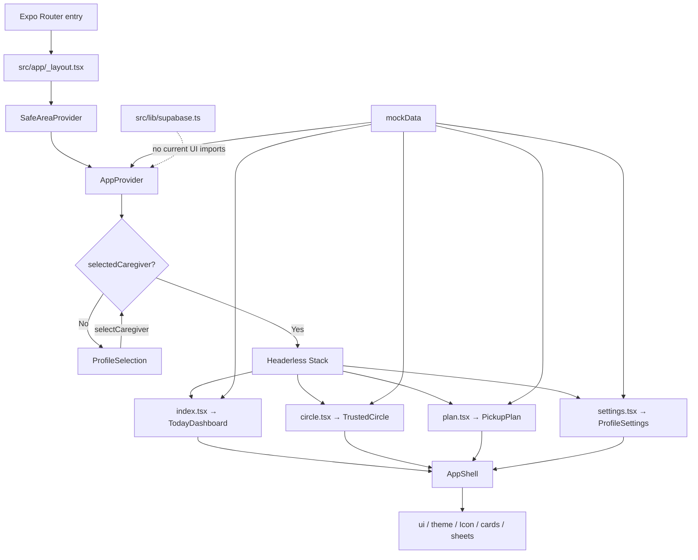
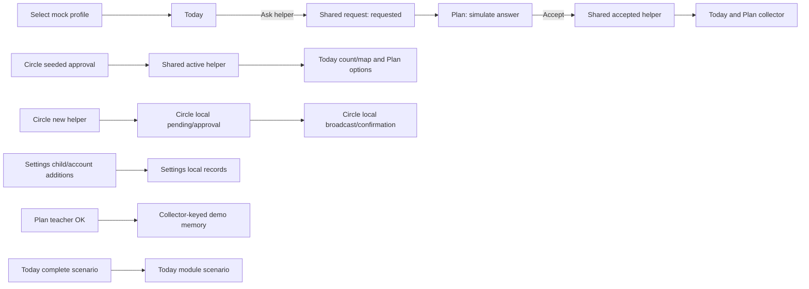
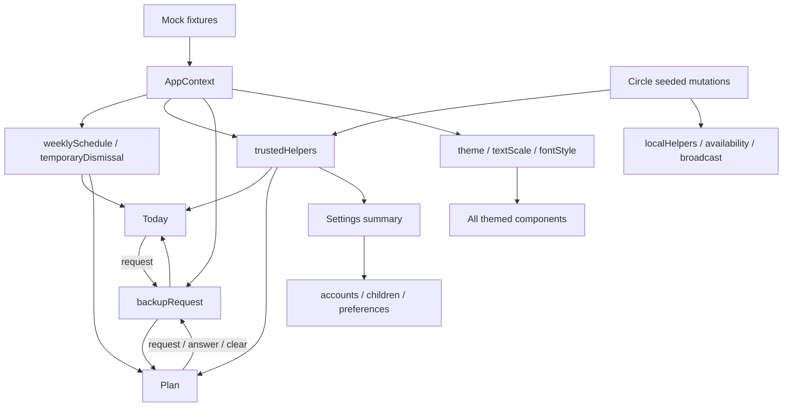

# SafeNest Frontend UI and Feature Reference

**Assessment:** 18 October 2026, Asia/Kuala_Lumpur · revision `909cb42`.

## 1. Executive summary and evidence boundaries

SafeNest is a four-route Expo React Native pickup coordination demonstration with a caregiver-selection gate. Its strongest integration is the shared weekly schedule, seeded helper approval state, Today/Plan backup request, and app-wide appearance. Circle invitations/broadcasts and Settings accounts/children/preferences remain fragmented across local component state. Teacher verification and Today completion are separate simulations.

This report was based on direct inspection of all 37 first-party TS/TSX files, application configuration, dependency diagnostics, asset references, and relevant design-reference CSS and interaction logic. The existing project update report was context, not a substitute for reading source. Backend inspection was limited to its client boundary and prospective frontend data contracts. Binary artwork was inventoried through paths/references; pixel appearance was not visually audited. The complete 6,317-line prototype was not executed or exhaustively audited for every historical behavior.

Only this Markdown report was created. No application, database, authentication, environment, dependency, or configuration changes were made. No Git branch or remote operation was performed. `SAFENEST_PROJECT_UPDATE_REPORT.md` was already untracked before this assessment and was left untouched.

Terminology used below:

| Status | Meaning |
| --- | --- |
| Demo implemented | Reachable UI and a handler/state path exist in source; runtime correctness is unverified. |
| Partial | A path exists but its lifecycle, propagation, eligibility, or scope is incomplete. |
| Disconnected | UI changes a separate state model from the feature on another screen. |
| Dormant | Source exists but current routes do not import/render it. |
| Future | No current frontend service implementation. |

All behavioral findings below are **static source findings**, unless listed as an executed command in section 13. No Expo Go, emulator, browser, screen-reader, gallery, WhatsApp, or database test was performed. A full TypeScript check failed with ten missing-module diagnostics. Interface presence is not evidence of live authentication, messaging, tracking, or teacher authorization.

## 2. Current UI architecture

`package.json` uses `expo-router/entry`. Declared versions are Expo `~57.0.28`, Router `~57.0.27`, React `19.2.3`, RN `0.86.3`, TypeScript `~6.0.3`, Reanimated `4.5.1`, Worklets `0.10.1`, and SVG `15.15.4`. Native inline styles and `StyleSheet` implement presentation. There is no active CSS utility framework or mapping SDK. Do not add libraries without approval.

The dotted edge denotes a missing integration, not a dependency. `_layout.tsx` wraps the conditional navigator inside the provider, so clearing the caregiver unmounts routed UI but leaves provider state alive. Profile selection is not a Router login route. Route files only compose their screen components. No additional application routes, nested Settings routes, or invite-consumption route were found.

`AppShell` supplies page titles, scrolling, safe-area spacing, tab bar, pending badge and transitions. Today supplies a map header and receives an overlapping rounded content panel. Other screens receive a normal titled page. Settings supplies an internal Back callback; its subpages use local `page` state, not URLs. Title changes scroll the shell to the top.

Bottom tabs call `router.replace`; selecting the active tab does nothing. Optional selection haptics swallow failures. Today shortcuts use `Link` to `/plan` and `/circle`, which can produce a different stack history from tab replacement. Do not assume route-local state survives navigation, or that all navigation paths have identical back behavior. Device back/deep-link behavior requires testing.

## 3. Detailed screens, feature inventory and interaction maps

Each table records purpose, visible controls, handler/state, ownership, outcome and limits. Together these tables form the frontend feature inventory. “Shared” means `AppContext` unless stated otherwise; all business state is memory-only.

### 3.1 Profile selection

**Source:** `src/components/shared/ProfileSelection.tsx`; gate in `src/app/_layout.tsx::RootNavigator`.

Layout: centered SafeNest logo, large “Who's using SafeNest?” heading, explanatory text, responsive caregiver-card grid, demo disclaimer. Each card has a large initial avatar, caregiver name and relationship. Scroll content respects top/bottom safe areas. Measured width `w` determines `cols` and card width `iw` using an approximately 144-point grid threshold.

| Interaction/feature | Function/state and outcome | Status/extension considerations |
| --- | --- | --- |
| Tap either mock caregiver card | `selectCaregiver(caregiver)` changes shared `selectedCaregiver`; gate mounts Stack | Demo implemented; no credential check, loading, failure state or registration |
| Scroll/grid adaptation | `onLayout` updates `w`; cards wrap | Static layout support; large text and narrow widths untested |
| Return after logout | Gate renders the same two `mockData.caregivers` | Custom Settings accounts and edits are not used to populate this chooser |

Logo and heading are informational. Cards are the only account-entry actions. There is no functional email/password/passkey login here.

### 3.2 Today Dashboard

**Sources:** `today/TodayDashboard.tsx::{TodayDashboard,TodayMap,Facts,NavRow,ChildChip,Alert,Inset}`, `today/DemoControls.tsx::{DemoSheet,FullMap}`, `shared/demoScenario.ts` and `shared/MapView.tsx`.

Visual hierarchy: edge-to-edge illustrated map with brand glass chip, Demo button, simulated-map legend and expand button; overlapping rounded panel with greeting/name and child dismissal chip; optional prioritized notice; dominant hero or warning status card; compact Plan/Circle navigation card; fixed shell tabs. Child chip, status facts, legend and person dots are displays, not child-switching or person-detail controls.

| Feature/control | Flow, handler and state | Effects/status/limits |
| --- | --- | --- |
| Greeting and child chip | Device hour selects morning/afternoon/evening; selected caregiver name; dismissal derives from `weeklySchedule` and matching `temporaryDismissal` | Shared edits reflected; no ticking clock subscription or school-calendar model |
| Hero status and facts | `pickupStatus` combines fixed fixture with selected scenario; accepted shared backup selects `collector`; derives `statusLabel`, `headline`, `journeyText`, `nextStep` | Demo implemented. Planned/on-track/late/covered/arrived branches; place adds road/school presentation. Fixed ETA, no travel calculation |
| Ask a helper | `requestBackup` chooses first active shared helper, calls `requestBackupPickup` | Today → Plan shared request; enabled for idle/declined and at least one active helper; disabled during requested/accepted |
| Request feedback | `backupMessage` and notice show requested/accepted/declined; card action label changes | Simulated, nobody contacted. First helper can already be scheduled collector; Circle availability is ignored |
| Notice prioritization | Any non-idle backup → fixture `schedule.changedToday` → matching temporary dismissal | Only one top notice; fixture change is currently unset. Hero still reflects temporary dismissal |
| Open Demo | `setDemoOpen(true)` → `DemoSheet` | Local overlay visibility |
| Pick Normal/road/school/late/complete | `setScenario(key)` updates module external store; selected radio row changes | Updates Today header/card only; sheet remains open until closed. Normal uses fixture ETA 35; road 12; school 0; late 50; complete 0 minutes |
| Close Demo | Shared sheet close/scrim/platform request → `setDemoOpen(false)` | Scenario remains in module memory |
| Expand map | `setMapOpen(true)` → `FullMap` native Modal | Uses current dots/trail, contain fit and safe-area overlays; close X/platform back sets false |
| Completed journey | Arrived scenario hides collector dot, draws fixed route and car dot for 5.2 seconds, then “Car stopped” | Visual simulation; new map instance can replay animation; no enforcement of teacher approval |
| Pickup plan row | `Link href='/plan'` | Displays fixture child/school; no editable child selector |
| Trusted circle row | `Link href='/circle'` | Count includes active shared helpers only, not Circle-local helpers |

Map coordinates are hard-coded in `PLACE_XY`/`BASE_XY`. Dots represent fixed family plus active shared helpers. The collector position uses office/road/school; rejected helpers can remain the resolved collector even though their map dots are filtered out. Full map has title, 48-point close control and bottom simulation disclaimer; it does not implement pan, zoom, GPS, route search or directions. Header height clamps window-height × 0.4 to 240–380 plus top inset. `Facts` stacks when measured per-item width is below `150 * max(1,effectiveScale)`.

Empty/error/loading: no asynchronous fetch or data-error UI. Missing collector uses generic text; missing active helpers disables backup. Waiting is simulated request status, not a network loading indication. A success-like “complete” scenario can coexist with the enabled backup action because action eligibility only checks request/helper state.

### 3.3 Trusted Circle

**Source:** `circle/TrustedCircle.tsx`, especially `approve`, `reject`, `removeHelper`, `renderMember`, `saveSelectedTime`, `simulateHelperApproval`, `addHelper`, `getContactDetail`.

Layout: page title/lead, persistent local notice, optional Waiting for approval card, Approved to collect card grouped into Emergency contacts and Helpers, Add New Helper button, Backup pickup card, Family card and simulation footer. Pending rows display avatar, name, relationship, optional age, contact and status plus explicit Approve/Reject actions. Approved/family rows collapse details by default.

| Feature/control | State/handler and exact flow | Effects/status/limits |
| --- | --- | --- |
| Expand person | `openIds[id]` toggled in `renderMember` | Shows phone, sample location, emergency tag, availability and contact actions; chevron rotates |
| Approve pending helper | `approve` updates `localHelpers` when local, otherwise `setTrustedHelperState(id,'active')`; sets `notice` | Seeded helper then appears in Today/Plan; local helper stays Circle-only |
| Reject pending helper | `reject` sets rejected in appropriate collection | Removed from visible pending/approved lists; no undo/rejected list |
| Remove approved helper | `removeHelper` deletes local row or marks shared helper rejected; clears local phone/availability/primary entries and broadcast recipient ID | Shared options/counts update; shared backup/scheduled collector is not reconciled. Immediate action, no confirmation sheet |
| Show availability | `availability` and `availabilityTimes` keyed by person | Busy or Available until; no expiry calculation and no Plan/Today integration |
| Toggle own availability | Owner-only `SmallBtn` calls `toggleOwnerAvailability` | Only row whose ID equals selected account can change. Other rows show read-only lock chip |
| Change own end time | `openTimePicker('availability')` seeds draft → wheel → `saveSelectedTime` | Saves owner entry in local time dictionary; does not make availability date-aware |
| Primary emergency contact | `togglePrimaryContact(id)` | Local flag/tag; approved helpers regroup into Emergency contacts. Family flags do not turn into a shared emergency model |
| Add New Helper | Opens sheet via `isAddModalVisible`; name, numeric age, relationship, optional phone | `addHelper` trims fields, requires nonempty name/role/age and integer age ≥0; no upper age or phone-format check |
| Send demo invitation | Timestamp ID → pending `localHelpers`, optional phone dictionary, availability false → notice → `closeAddModal` | Disconnected local invitation; no token, delivery, link or account. Form disables incomplete values; handler validates again |
| Close add sheet | `closeAddModal` clears every helper draft and error | Closing discards input; shared sheet close paths apply |
| Request backup | Disabled if no active locally available helpers; `openTimePicker('backup')` starts at 2:30 PM | Wheel save snapshots `availableHelpers` into `backupPickupRequest.recipientIds`, sets pending, notice |
| Send another request | Same action replaces prior local request/time/recipient snapshot | No queue, request history, cancellation button or shared request update |
| Simulate approval per recipient | `simulateHelperApproval` sets approved/name and opens confirmation sheet | Accepted badge/copy; checkmark graphic and “will pick up” message; Done closes confirmation only |
| Circle badge publication | `useEffect` publishes `localPendingCount`; cleanup clears store | Admin shell badge adds this to shared pending count. Local count disappears when Circle unmounts |

Recipient eligibility here is approved **and locally available**; Today/Plan use only shared approval state. New helpers start unavailable, and startup accounts are parents, so the normal UI cannot toggle a newly added helper's availability. A custom Settings account has no family directory row. Contact lookup reads mock caregivers plus `profileEdits`, fixed sibling contact and local helper phone; it does not read active Settings edits. “TODAY'S PICKUP” always uses fixture collector ID.

Empty/error/loading: no pending section when empty; “No approved helpers yet” in approved card; explicit no-available-helper caption and disabled request. Invalid form renders `Err`; no network spinner or transport failures. Notices use success banners even for some declined/removed outcomes. Removing a broadcast recipient can leave zero recipients without an escalation path; accepted `approvedBy` is stored as a name, not a reconciled person reference.

### 3.4 Pickup Plan

**Source:** `plan/PickupPlan.tsx`, context schedule/request operations, `TimeWheel.tsx`, `Disclosure.tsx`.

Layout: title/lead, local notice; Today dismissal card with clock icon, large time and optional temporary warning/reset; five regular weekday rows with today highlight, time/Edit; Backup collector status card with avatar radio rows; Teacher check status/collector card; collapsed Child and school details and How pickup works; one dual-purpose time sheet.

| Feature/control | Functions/state and transitions | Effects/status/limits |
| --- | --- | --- |
| Change today's time | `openDismissalSelector` copies current dismissal to `selectedDismissal`, opens `isDismissalModalVisible` | Local draft only until saved |
| Save temporary time | `saveDismissal` validates `validTime`, calls `setTemporaryDismissal({weekday:today,time})`, closes and sets notice | Shared Today/Plan. Labeled today-only but contains no date/expiry |
| Reset temporary time | `resetDismissal` sets override null | Reverts both screens to regular time; changes notice |
| Edit any weekday | `openWeeklyEditor` sets `editingWeekday`, `draftWeeklyTime`; same sheet switches title/explanation | Draft does not mutate saved week |
| Save regular time | `saveWeeklyPreview` calls `updateWeekdayTime(child.id,day,time)`; notice explains existing temporary override | Shared weekly schedule survives screen remount under provider |
| Cancel/X/scrim/back time sheet | `closeTimeSelector` closes both modes | No draft save; reopening reseeds. Save disabled unless regex accepts time |
| Select backup helper | `draftHelperId` tracks idle choice; `selectBackupHelper` retargets existing requested context request | Active shared helpers only; no availability filtering. Accepted/declined selection locked |
| Request or Ask again | `requestBackup` sends `requestHelper.id`; requested status and notice | Shared request; resolved request helper governs Ask again, not a newly chosen draft |
| Simulate accept/decline | `respondToBackup(boolean)` → shared accepted/declined; notice | Accepted collector substitutes in Today/Plan; Circle collector tag/broadcast unchanged |
| Clear request | `resetBackupRequest` restores fixture idle | Selection becomes editable; scheduled collector resumes |
| Prepare demo photo check | `prepareVerification` directly sets awaitingTeacher | No capture/upload; `photoPrepared` is renderable but not entered by this button |
| Simulate teacher OK/no | `setVerificationState('approved'/'rejected')`, explicit simulation notice | Approved shows reset; rejected allows prepare/retry; independent of Today completion |
| Reset verification | `setVerificationState('notStarted')` | Only this collector's current module record; no server |
| Expand child/school | Shared `Disclosure` local open state | Avatar, age/class; school/address/teacher, read-only |
| Expand How pickup works | `Disclosure` | Four numbered steps use current dismissal/collector; explanation does not enforce pickup sequence |

`availableHelpers`, `draftHelper`, `backupHelper`, `requestHelper`, `hasBackupRequest` and `isBackupResolved` distinguish draft from stored request. Do not collapse these concepts when extending selection. A request can retain a removed helper; `backupHelper` and scheduled collector lookups are not active-only. No helpers + idle shows empty guidance; request disabled without `requestHelper`. If helpers disappear during an existing request, no complete invalid-request recovery is enforced.

Verification uses local `{collectorId,state}`, module `savedVerification`, a derived same-collector visibility check and `useLayoutEffect`. It avoids showing another collector's decision during a mounted collector swap, but is not keyed by child/date/request/session. Away-and-back changes while Plan is unmounted can retain approval. No collector means decision writes return early. Waiting and success/rejection UI are demo states; no real teacher latency/error channel.

### 3.5 Settings/Profile

**Source:** `settings/ProfileSettings.tsx`, active child component `SchoolPreferences.tsx`.

Home layout: profile card with avatar/name/role/email and chevron; Preferences (Appearance/Notifications), Family (Family and school), Security and privacy rows; red Logout card and session disclaimer. Internal `page` values are account/appearance/notifications/family/security/privacy or null. `openPage`/`closePage` set page and `backed`; `Page` uses push/pop animation. There is no deep link to these subpages.

| Page/feature/control | Flow and named state/functions | Integration/status/limits |
| --- | --- | --- |
| Home profile card | `openPage('account')` | Same destination as account view; selected account stored in local `accounts`, `activeAccountId` |
| Account display | Large avatar/camera, identity, Active account chip; name/phone/email/relationship/password rows | Password is a local fictional demonstration string; never use real credentials |
| Show/Hide password | `showPassword` toggles displayed string vs mask | UI only; no reauthentication |
| Change active photo | `choosePhoto('active')` requests gallery permission, opens square editor, saves returned URI to account | Real platform action; no upload/durable storage. Denial/error feedback, cancellation returns silently |
| Edit details | `openAccountModal('editAccount')` seeds `draft`; `AccountSheet` offers photo/name/phone/relationship/email | `saveAccountEdit` validates required name/role, ≥9 phone digits, email regex; updates account + `selectCaregiver` |
| Save propagation | Context name reaches Today; account card updates locally | Circle still reads fixture names/old contact store. Photo stays Settings-only |
| Add account | Blank draft plus password; `addAccount` validates required name/password/role and contact format | Timestamp ID, non-admin, selects immediately. No minimum password length here, duplicate check or authentication |
| Switch account radio row | `switchAccount` sets active ID, context caregiver, login flag; hides password and sets feedback | Other local Settings state is retained while instance stays mounted; shared pickup data is not account-scoped |
| Forgot password | Opens sheet; `resetChannel` SMS/Email radio, target details; `sendResetPin` advances `pinSent` | Simulated delivery; fixed demo PIN (omitted here), no real reset request |
| Reset password form | PIN/new password/confirm; `resetPassword` checks fixed PIN, ≥8 characters and equality | Changes local account password only; `closeModal` clears reset fields/errors |
| Appearance | Theme Seg (Light/Dark/System), text Seg (Small/Medium/Large/Extra Large), four `FontPicker` tiles and preview card | Shared `setThemeMode`, `setTextScale`, `setFontStyle`; app-wide memory state |
| Push alerts | Three switch rows: Pickup Hour Reminder, Helper Availability Updates, App System Alerts | Local `pushNotifications`; home count updates; switches do not schedule/gate real events |
| Test Pop-up Notification | Sets `notificationBanner`; Dismiss sets null | In-app banner only; works irrespective of preference switches, not an OS notification |
| School alerts | Pickup alerts/Gate status/Delay alerts → `SchoolPreferences::togglePreference` | Child-local `preferences`; resets when Notifications subpage unmounts, even if Settings stays mounted |
| Family and school | One card per local child, age/class/avatar and school/address/teacher/phone rows | `children` seeded from mock; no active-child selection, edit or delete |
| Teacher WhatsApp | `openTeacherWhatsApp` strips non-digits, handles 00 prefix/local 0 → Malaysian 60, checks length, calls `Linking.openURL` | Real external URL; errors in feedback; no composed message or actual send confirmation |
| Add child | `openChildModal` clears draft; `ChildSheet` name/age/school/address/class/teacher/name-phone inputs | `addChild`: all fields required, integer age 1–18, ≥9 teacher-phone digits; append local child and close |
| Circle summary | Caregiver/family fixture counts; active shared-helper count | Excludes custom accounts and Circle-local helpers |
| Passkey toggle | `passkeyEnabled` updates active/not-set chip and enables methods | Simulation; no credential API/storage |
| Verification method | `passkeyMethod` radio rows: Device PIN, Face ID, Fingerprint | Disabled while toggle off; no biometrics; selection survives toggle off/on within instance |
| Privacy | Explanatory card | Memory/simulation statement; gallery access and external WhatsApp navigation are actual platform actions |
| Logout | `logOut` calls `clearCaregiver`, resets several local flags | Root gate unmounts routed screen; local signed-out account chooser branch is bypassed by parent gate |

`AccountSheet` uses photo preview/chooser and pinned validation/save footer; edit has no password input. `ChildSheet` has multiline address and pinned save/error. `closeModal` closes and clears reset/error state; account drafts are reseeded on open and child draft is reset on open. Helper add differs by clearing its draft at close. Settings feedback auto-clears after 4.5 seconds via effect; the test banner remains until dismissed/logout/unmount and can appear on other Settings subpages. Failure feedback uses the same `Banner kind='ok'` wrapper as success, which can communicate the wrong semantic color.

No photo picker busy state/debouncing exists; repeated presses can start overlapping asynchronous attempts. No backend loading, offline, save retry or conflict UI exists. The locally coded signed-out view offers login rows/create account, but cannot be counted as the normal logout experience under the current root gate. Screen remount rebuilds default accounts/children/preferences and can diverge from the still-selected edited/custom context profile.

### 3.6 Compact workflow maps

There are deliberately no edges from Circle broadcast to the shared request, Settings children to Plan, or teacher OK to Today completion: source does not implement them.

## 4. Design system

The sole design authority is `design_reference/SafeNest Pickup (2).html`. Native components recreate its concepts rather than loading its HTML. Visual parity, typography rendering and animation parity have not been measured.

| Semantic token | Light | Dark |
| --- | --- | --- |
| Background/card | `#F4F8FB` / `#FFFFFF` | `#0A1316` / `#122126` |
| Ink/muted/line | `#17313B` / `#526875` / `#D6E4E8` | `#E6F1F3` / `#9FB8BF` / `#25393F` |
| Primary/onPrimary | `#0F7D86` / white | `#2FC4C4` / `#04252A` |
| Primary soft/ink | `#DFF1F3` / `#0B5F69` | `#14383D` / `#8FE3E3` |
| Warning/ink | `#FFF3C4` / `#5E4B00` | `#3A3210` / `#F3DC8A` |
| Danger/soft | `#B3261E` / `#FDE7E4` | `#FF8A80` / `#3B1A17` |
| Success/soft | `#1D7C5D` / `#DFF5EE` | `#2FC4C4` / `#14383D` |
| Hero gradient | `#123747` → `#1B4D58` | `#0D2A35` → `#154049` |
| Hero button/ink | `#96E4E2` / `#0A2E3A` | Same |
| Map/block/road | `#E4EEF0` / `#D6E5E8` / white | `#14262B` / `#1A3238` / `#2A454C` |
| Park/water/trail | `#CFE6E6` / `#BAD7EE` / `#2B7DE0` | `#17383A` / `#1B3A52` / `#6FB1FF` |
| Pin/scrim | `#0E5F73` / `rgba(10,30,38,.45)` | `#5CC7DE` / `rgba(0,0,0,.6)` |

`theme.ts` also supplies six avatar colors per mode, hero-muted text, shadow and spacing/radius/type tokens. Spacing is 4/8/12/16/20/24/28; many components use inline 10/14/18 values too. Typical gutters 16, vertical gaps 14–16, cards radius 22, controls 12–16, pills 999, sheets radius 28. Theme type metadata is body 14/small 11/section 11/title 28/hero 32, but actual `T` is `s * 16 * textScale`; do not assume every screen consumes the metadata sizes.

Text scales are 0.92/1/1.15/1.3. `T` applies `fontFace`, optional tabular numerals, tracking, line height, alignment and surrounding tone. OS text multiplication is capped at 1.2. `useEffectiveScale` combines app scale, capped OS scale and font width for responsive decisions. Input font size floors at 16. Map/badge labels and avatar initials do not uniformly follow app text scaling.

Font labels are **platform substitutes**, not bundled font files: Work Sans uses system UI fonts; Serif uses Georgia/iOS and serif/Android; Antic uses Avenir Next/iOS and light sans/Android; Balloon Bold uses rounded/system combinations on iOS and sans/medium on Android. Web uses fallback stacks. `FontSpec` separates regular/bold, max weight, tight tracking and width factor; `fontFace` clamps/snaps weights. Preserve this contract for typography extensions.

Cards use bordered white/dark surfaces and soft shadows. Hero uses a measured SVG gradient and `ToneProvider`; warning uses semantic gold. Tone changes nested text/button/pill contrast. `Glass` is translucent color/shadow, not a true blur implementation. Btn kinds: p primary, s soft, o outline, t destructive-text, dash dashed. Standard minimum heights are 54 or 44 for small/dashed/text variants. Disabled/loading dims and disables the press target; loading renders Spinner, but current business flows rarely use that capability.

Inputs use focus-colored border/ring, themed fill and rounded edges. Sheets have full scrim, grab handle, title/X, scrollable body, max width 640 and max height 92%, safe-area bottom padding, iOS keyboard avoidance and optional pinned footer. The grab handle is decorative; no drag gesture dismisses a sheet. Scrim/X/platform back invoke caller `onClose`.

Motion includes 140ms press scaling, 340ms swaps, entrance stagger, 260ms Settings pages, pulsing status/map rings, 350ms tab indicator and 5.2s route drawing. Sheet opens use 250ms fade/380ms rise; close keeps mounted for 240ms. `anim` suppresses keyframes under reduced motion. Press, some CSS transitions and shell/tab animations do not fully honor reduced motion.

Accessibility support includes labels/hints, header/image/tab/switch/radio roles, selected/checked/disabled states, polite notices/errors, accessible map description and modal semantics. Risks needing runtime checks: fixed labels/OS cap, small dismiss target, disclosure uses selected rather than explicit expanded state, time-wheel discoverability, web modal focus trapping/restoration, contrast across tones and focus visibility. `Switch` is visual only; its enclosing `Press` owns semantics/action. Do not use it alone as a functional switch.

## 5. Complete frontend file and shared-component inventory

Paths below are relative to project root. Screen tables above document their internal controls; this inventory covers every TS/TSX source, including dormant code.

| File | Responsibility, dependencies and modification impact |
| --- | --- |
| `src/app/_layout.tsx` | Provider/safe area/gate/Stack; changing lifecycle affects all state and logout |
| `src/app/index.tsx` | Composes TodayDashboard |
| `src/app/circle.tsx` | Composes TrustedCircle |
| `src/app/plan.tsx` | Composes PickupPlan |
| `src/app/settings.tsx` | Composes ProfileSettings |
| `src/components/today/TodayDashboard.tsx` | Status composition, fixed map people, facts/notices/links; shared request/schedule consumer |
| `src/components/today/DemoControls.tsx` | Scenario sheet and fullscreen modal; consumes scenario store/MapView |
| `src/components/circle/TrustedCircle.tsx` | Shared/local directory mutations and isolated broadcast; pending-count publisher |
| `src/components/plan/PickupPlan.tsx` | Draft/saved scheduling, shared backup, module/local verification, detail disclosures |
| `src/components/settings/ProfileSettings.tsx` | Active Settings home/pages/forms/accounts/photos/children/security; local helper components Page, Note, FontPicker, MethodRow, SheetFooter, AccountSheet, ChildSheet |
| `src/components/settings/SchoolPreferences.tsx` | Active local school switches on Notifications page |
| `src/components/settings/AppearanceSettings.tsx` | Dormant older appearance section; duplicates part of active page, lacks active font picker |
| `src/components/settings/CaregiverProfileSection.tsx` | Dormant older contact editor/emergency disclosure; sole `saveProfileEdit` caller |
| `src/components/navigation/icons.ts` | 24×24 stroke markup dictionary; some icons unused; `Record<string,string>` widens key type |
| `src/components/navigation/Icon.tsx` | Memoized/cached parser for self-closing path/circle/rect; unknown names render empty; parser does not preserve arbitrary SVG attributes/elements |
| `src/components/shared/AppContext.tsx` | Shared state contract and validated weekly updates; highest cross-screen impact |
| `src/components/shared/AppShell.tsx` | Chrome/scroll/tab routing/badge/haptics/animations; module `previousIndex` tracks tab indicator |
| `src/components/shared/types.ts` | People/child/school/schedule/status/request/verification unions/interfaces; IDs are strings, simulations tagged true |
| `src/components/shared/mockData.ts` | Fictional seeds AND direct screen data source; changes affect initialization and displays differently |
| `src/components/shared/theme.ts` | Both palettes/scales/platform FontSpec/fontFace/tracking; changes affect every screen |
| `src/components/shared/ui.tsx` | ToneProvider/useTone/toneColors, alpha, useColors/useReduce/useEffectiveScale; T, Press, Btn, Rise, Pill, Chip, Spinner, Grab, Row, Dl, Banner, Glass, Field, Input, Seg, SIc, SRow, Switch, LRow, Lead, Err, Tag, SmallBtn |
| `src/components/shared/Avatar.tsx` | Image/initial circle, stable honorific-stripped palette hashing; `avatarIndex` also colors map dots |
| `src/components/shared/Card.tsx` | Tight/default/hero/warning card, tone propagation and measured SVG gradient |
| `src/components/shared/PrimaryButton.tsx` | Typed Btn p wrapper with loading/disabled/accessibility/leading content |
| `src/components/shared/SecondaryButton.tsx` | Equivalent Btn s wrapper sharing ButtonProps |
| `src/components/shared/SectionHeading.tsx` | Uppercase accessible themed section label |
| `src/components/shared/StatusPill.tsx` | Tone-aware pulsing Pill in hero/warn; semantic Chip elsewhere; neutral/info share default style |
| `src/components/shared/ProfileSelection.tsx` | Entry grid of fixture profiles; not backed by Settings accounts |
| `src/components/shared/Disclosure.tsx` | Collapsed Card/Press/Rise; local open state; Plan and dormant profile section |
| `src/components/shared/Sheet.tsx` | Shared modal lifecycle/animation, keyboard/scroll/footer; broad interaction impact |
| `src/components/shared/TimeWheel.tsx` | Hour/minute/AM-PM picker; tap/snap/settle, selection haptics, SVG fades; Circle and Plan |
| `src/components/shared/MapView.tsx` | Native SVG map/coordinate fits/person overlays; module precomputed curve samples and UI-thread animation |
| `src/components/shared/motion.ts` | Easing/worklet curves/KF/anim; shared animation and reduced-motion contract |
| `src/components/shared/demoScenario.ts` | `useSyncExternalStore` scenario module memory; Today only |
| `src/components/shared/pendingBadge.ts` | External local pending-count store; Circle writes, shell reads |
| `src/components/shared/profileEdits.ts` | External contact map/validators; Circle reads, dormant editor writes |
| `src/lib/supabase.ts` | Unimported future client; environment guard/session persistence/AppState refresh, no current UI consumer |

`TimeWheelPicker` is controlled by formatted string and `onChange`. Three columns contain 12 hours, 60 minutes and AM/PM; 42-point rows show three when screen height <700, otherwise five. Selection emits non-padded hour and padded minute. `WheelColumn` syncs scroll offset when selection/layout changes, settles on momentum end (plus drag end on web), clamps index and optionally triggers haptics. Test wheel scroll/tap, short-screen footer visibility and assistive input before extending it.

### Assets, reference and configuration

| Files/group | UI relevance |
| --- | --- |
| `assets/images/logo.png` | Active Today brand and profile-selection logo |
| `assets/images/icon.png`, `favicon.png`, `splash-icon.png` | App/web/splash references in app.json; splash background remains blue |
| `assets/images/android-icon-{background,foreground,monochrome}.png` | Adaptive Android icon configuration |
| `assets/expo.icon/icon.json`, `Assets/grid.png`, `Assets/expo-symbol 2.svg` | iOS icon composer/artwork, separate from in-app SafeNest logo |
| `assets/images/logo-glow.png`, `expo-logo.png`, `expo-badge.png`, `expo-badge-white.png`, `react-logo.png`, `react-logo@2x.png`, `react-logo@3x.png`, `tutorial-web.png` | Retained assets with no active source/config reference found; do not delete without coordination |
| `assets/images/tabIcons/home{,@2x,@3x}.png`, `explore{,@2x,@3x}.png` | Legacy tab artwork; active tab bar uses SVG icons |
| `design_reference/SafeNest Pickup (2).html` | Design/behavior authority, not imported by native UI |
| `package.json`, `package-lock.json` | Scripts/declarations/locked dependencies; installed tree currently differs |
| `app.json` | Portrait, automatic appearance, safenest scheme, static web, Router/splash plugins, typed routes/react compiler experiments |
| `tsconfig.json` | Strict Expo base, src/assets aliases, generated route/env types included |
| `AGENTS.md` | Ownership/prototype/frontend-only/validation rules |
| `README.md` | Starter onboarding; references reset script that is absent |
| `.gitignore` | Generated output/dependencies/environment exclusions; no runtime UI logic |
| `.vscode/settings.json`, `.vscode/extensions.json`, `.claude/settings.json` | Editor/plugin settings, not application feature logic |
| `LICENSE` | Licensing metadata; not UI logic |
| `supabase/schema.sql` | Future contracts, not a frontend implementation |

Ignored `.expo` route declarations/settings/logs and `expo-env.d.ts` are generated development artifacts, not proof of a current successful run. No separate first-party hooks directory, service/repository layer, test suite, API route tree or CI workflow was found in this source inventory.

## 6. State management and cross-screen relationships

| Owner/state | Lifetime and consumers | Consequence |
| --- | --- | --- |
| Provider `selectedCaregiver` | Until clear/provider restart; gate/Today/Settings/Circle/shell | Selection is a demo identity, not authorization |
| Provider appearance | Survives routed screen unmount/logout while provider lives | Settings offers app-wide session appearance, no durable preferences |
| Provider weekly/temporary/helper/request data | Survives normal route unmount and caregiver clear/switch | Shared across all selected profiles; no family/account/date isolation |
| Today local modal flags/measurement/refs | Component instance | Overlay/entrance state resets on remount |
| Circle local data | Component instance | Added helpers, phone maps, primary flags, availability, broadcast/confirmation/drafts/notices can disappear on navigation |
| Plan local drafts/notices/disclosures | Component instance | Unsaved edits lost; saved schedule/request remains shared |
| Plan module `savedVerification` | JS module lifetime | Survives remount/logout, not app restart; only one collector record, not a dictionary/history |
| Settings local accounts/photos/children/push/security/page | Component instance | Can disappear on route remount/logout; selected context identity may outlive its originating local account |
| SchoolPreferences local state | Notifications subtree lifetime | Resets simply by leaving that Settings subpage |
| Scenario external store | JS module lifetime | Today selection survives remount/logout independently of pickup request |
| Pending-count external store | JS module but Circle cleanup resets count | Does not persist local helper records or count across Circle unmount |
| Profile-edits external store | JS module lifetime | Currently no reachable writer; active Settings edits use a separate model |
| AppShell module `previousIndex` | JS module lifetime | Retains animation position, not business/session data |

No frontend business state is written to AsyncStorage/localStorage or a backend. Future client auth persistence is not persistence of UI state. React Native routing can retain previous stack entries on some paths; source does not guarantee every screen unmount on every navigation action. Use the actual route sequence to verify lifetime rather than claiming universal tab persistence/reset.

## 7. Existing UI issues and limitations

All findings in this table are confirmed by source data flow, except dependency blockers confirmed by commands. They have not been reproduced on a device.

| Priority | Finding and evidence | Practical impact |
| --- | --- | --- |
| High | Missing packages/invalid local dependency versions (section 13) | Typecheck fails; current bundling readiness unproven |
| High | Circle `backupPickupRequest` vs context `backupRequest` | Circle confirmation does not arrange Today/Plan collector |
| High | Circle `localHelpers` excluded from context | Newly approved helpers cannot be selected in Plan/Today and can disappear |
| High | Settings `logOut` clears caregiver under root gate | Local signed-out UI/custom accounts disappear; shared pickup data survives |
| Medium | Settings `children` vs fixture child/context guard | Add-child UI does not provide multi-child pickup planning |
| Medium | Weekday-only override; weekend clamps Sunday→Monday/Saturday→Friday | “Today only” can apply in later weeks; weekends show school-day fiction |
| Medium | Date/hour calculations have no clock/foreground subscription | Long-open views may display stale day/greeting/dismissal |
| Medium | Removed helper still resolved by accepted/scheduled collector lookup | Removed person may remain collector; map/card/options can disagree |
| Medium | Today picks first active helper, including scheduled collector | Backup can ask the same person; no shared availability filtering |
| Medium | Circle availability lacks expiry and newly added helper self-access | Displayed availability is not a reliable global eligibility model |
| Medium | Active Settings edit bypasses `profileEdits` and mock family names | Contacts/names differ across screens |
| Medium | Verification only collector-keyed and completion scenario separate | Stale approval across pickup instances; no enforced release workflow |
| Medium | Circle approval/removal handlers have no admin guard | Badge role filtering does not restrict actions for custom non-admin profiles |
| Medium | Local password/reset/passkey UI is simulated | Must not be represented as credential security or authentication |
| Medium | Add-account password only nonempty; helper phone/age weak validation | Validation rules inconsistent; duplicate identities not prevented |
| Medium | Error feedback wrapped in success-colored Settings banner | Gallery/WhatsApp failures can visually resemble success |
| Medium | No async photo busy/retry lifecycle or backend load/error model | Future service integration cannot reuse current synchronous assumptions unchanged |
| Low/medium | Fixed text/OS cap, partial reduced motion, unverified modal focus/wheels | Accessibility/layout certification remains outstanding |
| Low | Dormant Settings components, divergent validators, retained starter assets | Future developer may extend unreachable code or duplicate models |
| Low | Missing reset script and generic README | Existing onboarding command is stale; do not run it during analysis |

## 8. Prototype behavior and current native boundaries

Relevant reference symbols: `KIDS` (~2512), `tick`/`fireCircle`/`reply` (~4552–4594), `renderToday`/`renderCircle`/`renderPlan` (~4747–4798), `UILANGS` (~4824), `teacherMsg`/`photoMsg`/`sheetHTML` (~4999–5020), `renderLogin` (~5394). Reference line numbers are for this revision and may move.

The prototype contains four languages, child switching, browser persistence, automatic late-triggered backup, staggered replies/all-no behavior, message composition/copy/WhatsApp sheets and richer demo controls. Native code has English strings, single-child pickup data, manual split requests, fixed scenario ETA and no message-composition/clipboard flow. Its account/passkey/photo verification flows are local simulations. These are reference gaps, not approval to implement them or a newly invented roadmap. Preserve prototype intent and obtain acceptance scope through team coordination before changing behavior.

## 9. Feature expansion readiness

| Screen | Extension points and reuse | State/navigation dependencies and risks |
| --- | --- | --- |
| Today | `TodayMap`, `Facts`, `Alert`, shared hero/Btn/MapView, DemoSheet | Derivation mixes fixtures/context/scenarios; coordinate any new pickup state with Plan/Circle. New child/status affects headline, facts, dot eligibility, notices and shortcuts together |
| Circle | `renderMember`, approval handlers, helper sheet, time picker, shared cards/actions | New entities need agreed shared owner; availability/primary contacts are not in shared types. Broadcast integration changes Plan/Today contracts and badge lifecycle |
| Plan | Validated context weekly action, draft separation, shared time sheet, Disclosure | Date/child/request identity missing; future pickup instance must coordinate verification, collector and completion. Preserve temporary-vs-regular separation |
| Settings | Internal `page`, AccountSheet/ChildSheet/SheetFooter, shared rows/Seg | Local account/child domain types duplicate shared concepts. New URL-addressable page needs explicit route/back design. Photo/permissions need busy/error/session handling |
| Profile selection | Responsive card pattern and gate | Future auth/account source changes belong with root integration owner, not a cosmetic chooser edit |

Reusable visuals are ready for incremental additions. Shared domain/lifecycle contracts are only partially ready for cross-screen additions. Changes to context rerender consumers; this is an architectural consideration, not a measured performance issue. Shared UI, theme, shell, types, fixtures and Sheet have broad indirect effects. Avoid introducing new module stores solely to bypass coordination.

## 10. Backend integration awareness

No screen imports `src/lib/supabase.ts`; source searches found no application data fetch/realtime/repository path. The client reads public Supabase configuration names, throws on absent configuration when imported, configures AsyncStorage auth sessions and AppState refresh. It was not imported or executed during assessment. No environment values are included here.

| Frontend concern | Prospective schema/interface | Coordination required; not implemented |
| --- | --- | --- |
| Account identity/family roles | `profiles`, `families`, `family_members` | Root session gate, loading/error/logout, family-scoped state; display role/isAdmin cannot be server authority |
| Directory/approvals/invites | `trusted_helpers`, `helper_invites`; create/accept invite RPCs | UUID adapters, linked account consent, invite URL route/auth handoff; helper linkage does not itself create family membership/request access |
| Children/school | `children` | Shared active child, flattened DB school fields vs current mock `School` object |
| Weekly school time | `pickup_plans` | Child/family identity and weekday records; current context only accepts fixture child |
| One-day changes | `dismissal_overrides` | Actual date/reason model vs current weekday/time object |
| Backup request | `backup_requests` | DB idle represented by no active row, cancelled exists; frontend idle/requested/accepted/declined, Circle pending/approved differ |
| Photo/teacher/completion/location/preferences/availability/passkeys | No complete matching source model | Agree separate contracts with backend owner; do not infer storage or authorization support |

Database IDs are UUIDs; mnemonic/timestamp demo IDs need adapters. Frontend should eventually distinguish save pending/success/error, stale requests, access denial and data loading; currently those states do not exist. This is integration guidance only. No SQL, auth code, environment or backend config was changed, deployed or tested.

## 11. New-feature implementation guidelines

1. Read `AGENTS.md`, the latest prototype's relevant render/action logic and the active route import chain. Check whether the component being considered is reachable.
2. Coordinate ownership: Member 1 Today, 2 Circle, 3 Plan, 4 Settings, 5 navigation/shared/design/integration. Agree intended files before edits; do not overwrite another member's active work.
3. Define one owner for a domain entity. Share cross-screen business state through the agreed contract; keep drafts, sheet visibility and expansion local. Specify tab/account/logout/restart/date behavior before adding another state collection.
4. Reuse `AppShell`, `T`, Card variants, Avatar, Btn/wrappers, SectionHeading, StatusPill, Field/Input/Err, Sheet and TimeWheel. Use Seg/LRow/SmallBtn/SRow and correctly wrapped Switch for matching interactions. Keep screen-specific composites within their owner folders.
5. Preserve draft/save/cancel boundaries and disabled conditions. Validate handlers as well as UI controls. Do not describe a local mutation as a sent invitation, real teacher approval, persisted account or delivered alert without explicit simulation labeling.
6. Coordinate shared types/context/mock changes across every reader and writer, including Today count/map, Plan helper/request/collector, Circle badge and Settings summaries. Add eligibility reconciliation when approved data can later be removed.
7. Preserve future compatibility using explicit domain-to-database adapters and clear identity/date/request boundaries. Do not couple components directly to new SQL/auth code while that integration is owned elsewhere.
8. Do not install packages/change config without approval. Inspect installed dependencies and version-specific official API documentation if implementing platform behavior; this assessment does not certify API compatibility.
9. Test the concrete state transition and its consumers, cancellation, invalid input, empty states and remount/account boundaries. Verify Expo Go navigation/scrolling/safe areas/keyboard, plus theme/text/font combinations and reduced motion. Run `npx.cmd --no-install tsc --noEmit`; report failures honestly.

### Practical pre-change checklist

- [ ] Confirm assigned feature/owner and intended files; preserve existing worktree changes.
- [ ] Read relevant prototype UI and handlers plus reachable native code.
- [ ] Trace all shared readers/writers, module stores and direct fixture reads.
- [ ] Specify data identity, eligibility, source of truth and state lifetime.
- [ ] Specify visible success/error/empty/waiting/disabled and cancel behavior.
- [ ] Reuse theme/type/tone/layout/control components and accessibility semantics.
- [ ] Confirm no conflict with the backend team; no unauthorized dependencies/services.
- [ ] Check interactions in Expo Go and record actual device/platform/scenario results.
- [ ] Run type check and focused available checks; disclose blockers and untested cases.
- [ ] Review diff for unintended changes; report files, behavior, simulations and limitations.

## 12. Frontend recommendations and acceptance matrix

Prioritize restoring the approved dependency environment, then coordinate consolidation of helper/request/profile/child state and session/date/pickup-instance semantics. Those changes have larger integration value than adding more isolated forms. Keep frontend demos explicit while the backend owner develops authentication and database integration. Record prototype acceptance scope rather than silently dropping or expanding workflows.

| Area | Meaningful future runtime acceptance cases |
| --- | --- |
| Entry/navigation | Both profiles, all tabs/Today links, active tab, Settings Back, hardware back, deep links, logout/reselection, web reload |
| Schedule | Every weekday, midnight/noon/minute extremes, wheel tap/scroll, cancel/save/reset, regular vs temporary independence, weekend/date rollover/foreground |
| Shared request | Today request→Plan→retarget→accept/decline→Today→clear; no helpers, removed current helper, same collector, retry after decline |
| Circle | Seeded/local approve/reject/remove, primary grouping, pending count across navigation, own/read-only availability, broadcast replacement/removal/confirmation |
| Verification | Prepare/reject/retry/approve/reset; collector swap mounted/unmounted, new day/request, logout, independence from Today complete |
| Settings | Validation and cancel, edit/switch/add/remount, custom non-admin, child scope, gallery denied/cancel/error/success, WhatsApp normalization/failure, preference subtree resets |
| Visual/accessibility | Small phone/landscape/tablet/web, keyboard/scroll/footer, light/dark/system, every font/text scale, OS scale, reduced motion, screen reader and web focus |

These are proposed acceptance checks, not tests claimed to have passed. No new test tooling was introduced.

## 13. Checks actually performed

| Check | Result and boundary |
| --- | --- |
| Working tree/revision | `git status --short` initially showed only existing untracked project update report; revision `909cb42` |
| Source inventory and inspection | Read every first-party TS/TSX source, route/configuration, relevant prototype fragments; inspected asset references and future backend boundary |
| `npx.cmd --no-install tsc --noEmit` | Failed with 10 diagnostics: SVG in Icon/Card/MapView/TimeWheel (4), Image Picker in ProfileSettings (1), Haptics in AppShell/TimeWheel (2), URL polyfill/AsyncStorage/Supabase in client (3) |
| `npm.cmd ls --depth=0` | ELSPROBLEMS: seven missing declarations and two invalid installed versions; npm also reported inability to write its cache log |
| Import/service searches | No UI Supabase consumer; active Settings does not call profileEdits writer |
| Final file review | Only requested report added by this task; no application/backend edits |

Missing installed packages: `@expo/vector-icons`, `@react-native-async-storage/async-storage`, `@supabase/supabase-js`, `expo-haptics`, `expo-image-picker`, `react-native-svg`, `react-native-url-polyfill`. Installed Router `57.0.26` conflicts with `~57.0.27`; installed Linking `57.0.12` conflicts with `~57.0.13`. Missing type information may conceal later diagnostics; restoring packages does not guarantee a clean check.

No dependencies were installed. No lint setup, production export, browser automation, Expo Go session, permission prompt, external URL launch, live service or SQL execution occurred. Source findings establish implementation paths and gaps; they do not certify runtime, visual parity, accessibility or release readiness.
