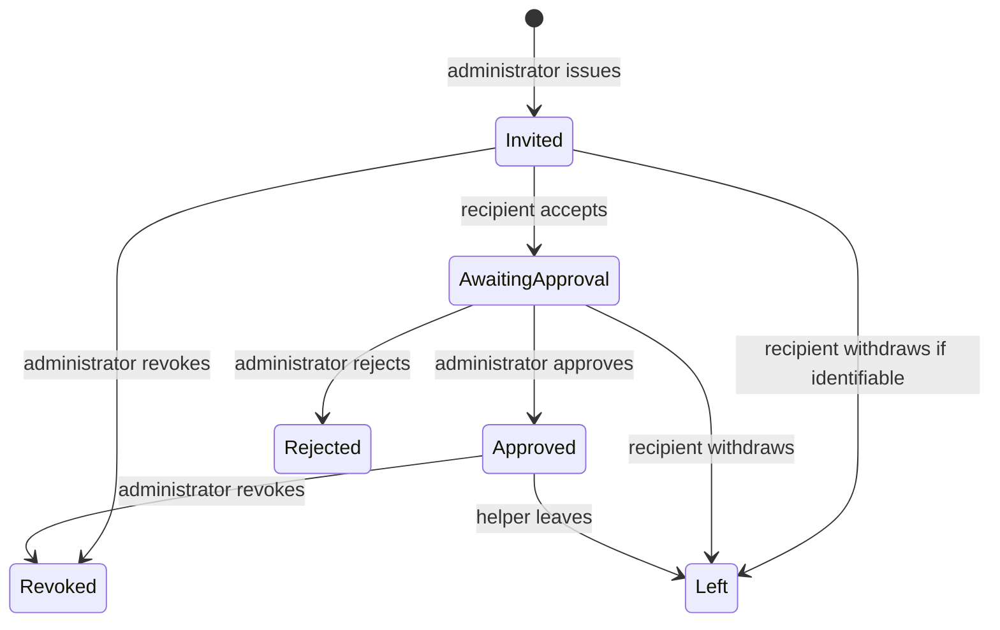

# Trusted Circle Integration Contract — Proposal for Frontend and Database Agreement

**Reviewed:** 18 October 2026 (Asia/Kuala_Lumpur). **Baseline:** Git `909cb42` plus the current uncommitted Trusted Circle implementation. **Status:** design proposal, not an approved migration or implemented API.

## 1. Scope and decision summary

This document compares current source with the intended invitation → acceptance → administrator approval → helper membership → pickup-request workflow. Only this document was created. No application, SQL, authentication, dependency, environment or configuration file was changed. No backend connection, schema deployment, real invitation, token generation, link acceptance or push delivery was attempted. Existing uncommitted work is preserved.

The existing schema is a useful starting point, but does **not** implement the full workflow. Its invite functions link an account to an existing helper row; helper approval and restricted request access are not coordinated. A linked helper cannot currently read their family's name or backup requests unless separately granted family membership. Granting ordinary family membership would expose much more child/schedule data and write authority than a helper requires.

Recommended decisions, all requiring agreement:

1. Keep internal family membership (`family_members`) distinct from a trusted helper's limited membership (`trusted_helpers` or an agreed replacement). Do not insert helpers into ordinary family membership just to make reads work.
2. Separate invitation lifecycle from membership approval. Acceptance must never grant pickup permission; approve only a linked, accepted, pending helper.
3. Initially reuse targeted, single-use invites for an existing helper record. A reusable family-wide join link needs a different data model and must be separately scoped.
4. Use server-authorized transitions with identity from the authenticated session, restricted read projections, immutable entity ownership, audit timestamps, and tests for direct writes as well as RPC calls.
5. Agree a single shared frontend membership/request source before connecting Circle, Today and Plan. Do not keep the current demo reducer as a second live database.

## 2. Evidence and current frontend models

Reviewed directly: `AGENTS.md`, `SAFENEST_UI_FEATURE_REPORT.md`, all four `src/components/circle/` files, `shared/AppContext.tsx`, `shared/types.ts`, `src/lib/supabase.ts` and `supabase/schema.sql`. Source names below are navigation references; this proposal does not alter them. The older UI report predates the new Circle tabs and is historical context. Its earlier missing-dependency findings are not current backend evidence; the preceding task's command-line TypeScript check passed. No database behavior has been tested here.

### 2.1 Current Circle-only models

`circleDemo.ts` defines:

| Model | Actual fields/values | Limits for integration |
| --- | --- | --- |
| `DemoActor` | `id`, `isAdmin` | Mock identity; not an authenticated principal or family-scoped permission |
| `DemoMembership` | `id`, `familyId`, `familyName`, `userId`, `userName`, role fixed to `Trusted helper`, `status`, `invitationStatus` | No timestamps, expiry, consent history, approved/revoked actor, availability or database version |
| `MembershipStatus` | `pending`, `awaitingApproval`, `approved`, `revoked` | UI vocabulary; schema has no direct equivalent enum |
| `DemoInvitation` | `familyId`, target user ID/name, `status` | No invitation ID, helper ID, expiry or real token. Only one invitation per Circle screen instance |
| `InvitationStatus` | `preview`, `accepted`, `approved`, `revoked` | Mixes a UI preview with approval/termination of a membership; should not become the production invitation enum |
| `CircleDemoState` | Nullable invitation + memberships array | One screen-owned reducer. New state survives My/Joined tab switching, resets on Trusted Circle unmount |

`createCircleDemoState` gives Abu four fictional family memberships, one per displayed status; Siti/custom accounts start empty. A user can have several membership IDs even when all rows share their user ID. `circleDemoReducer` generates one local invitation addressed to the other seeded caregiver, creates a pending helper membership, simulates acceptance to awaiting approval, and simulates approval. Its actor guard requires the mock admin flag and a hard-coded demo family admin ID. The administrator acts out the other user's acceptance; this is not the identity model for the live API.

Leaving an eligible owned membership marks it revoked. For the generated example, the reducer also marks its invitation revoked. Production must preserve an invitation's historic consumption separately from later leaving/revocation. `isDemoPickupEligible` tests only `status === approved`; it is explanatory UI logic, not live authorization.

### 2.2 How the active components use these models

| File | Current responsibilities and handoff needs |
| --- | --- |
| `TrustedCircle.tsx` | Owns reducer, My/Joined selection and invitation visibility; filters Joined records by selected caregiver ID. Existing seeded helpers use AppContext, added helpers use local state. Local broadcast request is separate from context backup request. Preserve controls while replacing their data source deliberately |
| `InvitationSheet.tsx` | Admin-only generation/acceptance/approval demo controls; selectable nonfunctional text; browser clipboard, native/browser sharing with busy/error feedback. Content is not a URL/token. Share completion does not prove delivery. Live acceptance must move to the recipient's authenticated route |
| `JoinedCircles.tsx` | Family-name/role/status cards, detail sheet and confirmed leave. Keys and leave requests use `membership.id`, not `userId`. No child data/location rendered. Eligible leave includes pending, awaiting approval and approved; revoked is terminal in demo |
| `AppContext.tsx` | Selected caregiver, shared seeded helpers, weekly/temporary schedule, one shared backup request and appearance. No joined-membership or invitation model, no family switch, no authenticated session. Request/respond methods are unguarded local mutations |
| `shared/types.ts` | `TrustedHelper`: ID/name/relationship/state/location label; `ContactState`: active/pending/rejected. `BackupRequest`: idle/requested/accepted/declined, optional helper ID/time, simulated true. No family/user membership linkage in helper type |

The new membership reducer intentionally does not create an active Today/Plan helper. Existing add-helper, approve/reject/remove, availability, primary contacts and Circle broadcast remain distinct demo mechanisms. A future migration needs explicit reconciliation, not side-effecting a live mutation from each of these competing models.

`src/lib/supabase.ts` exports a configured client with AsyncStorage auth session persistence, URL polyfill, AppState refresh control and `detectSessionInUrl: false`. Import throws if required public configuration is absent. Circle does not consume it. It does not supply invite routes, auth handoff, repositories, typed adapters or session-scoped query cleanup. Auth persistence is not persistence of Circle demo state. Coordinate its lifecycle with the auth owner; never introduce service-role credentials into the frontend.

## 3. Existing SQL capabilities — source only

The following describes `supabase/schema.sql`, not verified deployed objects, privileges or endpoints.

| Object | Existing shape and behavior | Reuse and gap |
| --- | --- | --- |
| `profiles` (~6) | Auth-linked UUID; full name, display role, email, phone, created time; RLS read/update self | Reuse authenticated user identity. Display `role` is self-editable and must not authorize family admin actions |
| `handle_new_user` / signup trigger (~31/51) | Inserts profile from Auth on signup; definer, empty search path; direct execute revoked | Reuse subject to signup/backfill/deployment tests; no proof existing users have profiles |
| `families` (~60) | UUID, name, creator, created time; read by family members, update by admins | Reuse ownership. Linked helpers cannot fetch family name with current policy |
| `family_members` (~67) | Composite `(family_id,user_id)` key, role admin/member, created time; user index | Internal family scope and multi-family structure. No pending/helper/revoked/left state |
| `is_family_member`, `is_family_admin` (~77/87) | Definer membership lookups based on `auth.uid()` | Reuse internal permission primitives; neither recognizes linked helpers |
| `create_family(text)` (~98) | Auth required; family and caller's admin membership inserted together; returns family UUID | Reuse family bootstrap; not an invitation operation |
| `trusted_helpers` (~140) | UUID; family/name/relationship `role`/phone; nullable linked `user_id`; state active/pending/rejected; inviter/created time | Candidate membership entity; helper-row ID is distinct from profile ID. Composite unique `(id,family_id)` ensures cross-family FK validity, not one membership per user/family |
| `helper_invites` (~281) | UUID; family/helper IDs; unique token hash; creator; seven-day default expiry; used-by/time, revoked time, created time | Reuse single-use targeted invitation history/hash/expiry. RLS enabled; script supplies no direct grants/policies. Actual default privileges must still be inspected |
| `create_helper_invite(uuid)` (~305) | Any authenticated family member may issue for a helper; revokes old unused/unrevoked invites, generates raw value, stores SHA-256 hash and returns raw text | Reuse core generation pattern after authority/state/concurrency agreement. Not admin-only, returns no structured metadata, no share-link route |
| `accept_helper_invite(text)` (~334) | Auth required; locks valid unused/unrevoked/unexpired invite; links helper only if `user_id` is null; marks invite used; returns family UUID | Reuse atomic claim core. Does not change helper state, record accepted approval phase, create family membership, grant request access, or constrain claim to pending helpers |
| `backup_requests` (~178) | UUID; family/child/helper/requester IDs; requested/accepted/declined/cancelled; request/response timestamps | Reuse request entity and same-family FKs; no pickup date/deadline/group-recipient model, transition RPC or linked-helper policy |
| `children`, `pickup_plans`, `dismissal_overrides` | Family-scoped child/school details, weekly plans, dated overrides | Needed for pickup operations, not Joined Circles reads. Ordinary family members currently have broad read/write access |

Invite function execution is revoked from public/anon and granted to authenticated in source. Definer functions have empty search paths. Same-family composite FKs prevent cross-family helper/child references in plans/requests. These are useful controls but not proof of complete authorization, race safety or deployment correctness.

## 4. Proposed identity and storage contract

### 4.1 Entity boundaries

- **User ID:** authenticated profile UUID. Derive actor from the server session, never a client-supplied `DemoActor`/user ID.
- **Family ID:** stable family UUID; every family-bound operation validates its scope.
- **Internal family membership:** admin/member capability, distinct from helper approval.
- **Helper membership ID:** recommended reuse of `trusted_helpers.id`, if the database developer agrees. One row binds a helper to one family; `user_id` can be null before acceptance. Relationship text is not an authorization role.
- **Invitation ID:** one issue attempt for a helper membership; not the membership itself. Reissue can invalidate old unconsumed invites without deleting membership history.
- **Request ID:** pickup assignment/request identity; must not be derived from helper or user ID.

Recommend at most one nonterminal helper membership per `(family_id,user_id)` when user ID is nonnull. Decide whether a revoked/left row is reused on reinvitation with audited reapproval or a new membership history row is created. Existing SQL has no such uniqueness rule. A user may administer their own family and help several other families; role and permissions must be evaluated separately in each family.

### 4.2 Required fields and invariants

Names marked **proposed** are semantic requirements, not migration commands or assertions that columns already exist. The DB owner may choose equivalent normalized tables/events instead.

| Lifecycle | Existing reusable fields | Required additions or enforced invariant |
| --- | --- | --- |
| Generate | Invite ID/family/helper/hash/created_by/created_at/expires_at/revoked_at | Actor must be current family admin; helper belongs to family and is eligible for invitation; timestamps assigned server-side; serialize reissue per helper. Optional recipient binding if product requires named invitee protection |
| Accept | `used_by`, `used_at`; helper `user_id` | Enforce live pending/nonrevoked membership; bind caller once; record membership `accepted_at` (proposed) or derive from a canonical accepted invite; consume invite atomically; no auto-activation |
| Approve | Helper pending→active | Require prior authenticated acceptance; proposed `approved_by`, `approved_at`; one authoritative status/version; immutable family/user binding during ordinary updates |
| Reject/revoke | Helper rejected is available, invite revoked_at exists | Proposed membership termination kind (rejected/revoked/left), `terminated_by`, `terminated_at`; optional private reason. Declining a join request differs from revoking approved access |
| Leave/withdraw | No self-service transition | Derive self from session; owned eligible helper membership only; retain relationship history with minimal data; invalidate future requests and unused invites atomically; record left distinction |
| Read Joined Circles | Own helper-row SELECT exists | Restricted family display name and membership projection; owner can read nonactive membership summary if retention policy allows. Exclude raw/hash tokens, inviter contact, children and locations |
| Receive/respond | Request/requester/helper IDs and timestamps | Approved linked helper; server-defined pickup instance/date/deadline/expiry; response allowed only by addressed current helper while requested; immutable request ownership; respond/cancel timestamps and concurrency control |
| Availability | No schema model | If filtering is required: agreed availability flag/window with timezone, expiration and owner-write policy. Membership approval alone does not mean currently available |

Use UTC server timestamps; display in the relevant family/user timezone. Product must define the timezone for local pickup dates and deadlines. Do not promote helper ages, contact lists or location labels into the contract just because legacy demo forms contain them.

## 5. Status mapping and permitted transitions

Keep separate production lifecycle concepts. Proposed membership statuses: invited, awaiting_approval, approved, rejected, revoked, left. Proposed invitation status: issued, consumed, revoked, expired (often derived from timestamps). Neither set is currently the SQL enum. Names remain negotiable; invariants do not.

| Frontend value | Candidate current-SQL derivation | Required rule/ambiguity |
| --- | --- | --- |
| Membership pending | Helper pending + user_id null + live issued invitation | Pending may also mean an uninvited legacy helper. Define copy as invitation pending only when invitation exists |
| Membership awaitingApproval | Helper pending + linked user + proven acceptance | Existing SQL can approximate from linked user/used invite, but links can currently be supplied on insert; linkage alone is not trustworthy acceptance evidence |
| Membership approved | Helper active + linked user + acceptance + approval audit | Active alone is insufficient; current schema permits active but unlinked helpers |
| Membership revoked | Helper rejected plus termination metadata | Existing rejected conflates rejection, revocation and voluntary leave. An adapter cannot reconstruct missing history |
| Demo invitation preview | No production equivalent | Local presentation state. A live issued invitation requires actual server creation |
| Demo invitation accepted | Invite used_at/used_by set | A consumed invitation is not an approved membership |
| Demo invitation approved | Membership approved; invite stays consumed | Do not mutate consumed invite into a new approval status merely for UI compatibility |
| Demo invitation revoked after leave | Membership left; historical invite stays consumed | Revoke unused invites independently; leaving must not erase original acceptance |
| Legacy helper active/pending/rejected | Candidate approved/invited-or-awaiting/rejected-or-revoked-or-left | Introduce typed adapter and explicit migration rules; never guess a positive authorization state |
| Backup idle | No actionable request | Not a DB row state |
| Backup requested/accepted/declined | Same existing DB values | Require matching actor, allowed previous state, eligibility and deadline |
| Backup cancelled | Existing SQL value; absent shared frontend union | Agree display/reset behavior; don't silently map to declined |
| Circle broadcast pending/approved | Separate local request terminology | Not membership approval. Needs an agreed broadcast/request-recipient model or a scoped one-helper first phase |



Invitation expiry blocks acceptance of an unconsumed invitation. It must not automatically expire an already accepted pending membership or an approved membership. Reinvitation/reactivation must be a deliberate audited policy, not an unrestricted status assignment. Pre-acceptance self-withdrawal is possible only if recipient identity is already securely bound; the current bearer-link schema cannot list an unclaimed pending invite under a particular user.

## 6. End-to-end workflow contracts

### 6.1 Administrator creates and shares

1. Authenticated UI obtains server-provided family capabilities; visibility is convenience, not security. Resolve family and helper membership IDs separately.
2. Create an invited helper record through an agreed admin operation, or select an eligible unlinked pending helper. Current `create_helper_invite` requires a pre-existing helper ID; it is not a family-wide link generator.
3. Server validates current admin authority, family ownership, helper status, intended recipient policy and reissue constraints. Atomically invalidate older unused invitations and issue the new one. Lock the helper as well as the relevant invite records, or use an agreed equivalent constraint, to prevent concurrent issuance races.
4. Return invitation metadata plus a one-time share artifact through an agreed secure response. Existing RPC returns only raw text; expiry/ID/status need a revised result or safe metadata lookup. Store hashes server-side and do not return token hashes to UI.
5. Construct the approved app/web link only after domain, path, expiry, auth handoff and routing are agreed. This document contains no real/example token or working link. Do not reuse the current nonfunctional preview in live mode.
6. A successful copy/share operation means the device processed an action, not that the recipient received or accepted it. Handle cancellation, denied copy permission, expiry and retries without false delivery claims. Never log the share artifact.

### 6.2 Recipient opens and accepts

1. An agreed app/universal-link or web route receives an opaque invitation reference. Do not accept automatically on GET, route mount, share preview or link-scanner visit.
2. If authentication is needed, the auth owner preserves only the necessary pending intent through login and validates the allowed return destination. A demo caregiver choice cannot establish recipient identity. `detectSessionInUrl: false` and current routes do not implement this handoff.
3. Present a minimal invitation preview and explicit Accept/Cancel. Decide whether preview requires authentication; there is no current preview RPC. Avoid a public family/profile enumeration endpoint. No child/school/phone/location details are needed to consent.
4. On explicit acceptance, server derives user from session, validates issue state/expiry/revocation/recipient binding, locks and consumes exactly once, binds the membership and enters awaiting approval in the same transaction.
5. Return the caller's restricted membership summary with stable membership ID and family display label. Current accept RPC returns only family ID; a normal family lookup currently fails for linked helpers.
6. Show Awaiting Approval and no pickup actions. Another device retry should return an agreed idempotent outcome for the same authenticated claimant, without allowing a different user to claim. Existing function rejects a used link rather than supplying this result.

Bearer-link possession currently allows any authenticated user to claim an eligible unlinked helper row. If links are intended for a specific email/account, secure server-side recipient binding and verification are required; a client-entered email or helper display name is not identity proof.

### 6.3 Administrator approves or rejects

Admin reads a family-scoped queue of accepted pending helper memberships using a safe profile projection. Approve/Reject targets **membership ID**, validates family-scoped admin and expected previous state, records actor/time and returns canonical state. Approval requires accepted linkage; issuing or merely opening an invitation cannot satisfy it. A stale queue should show a conflict/refresh, not overwrite a newer revoked/left state. Approval in one family must not activate the same user in another.

Current admin UPDATE policy permits setting helper state, but no function enforces this sequence or immutable linkage. A constrained RPC is recommended, together with removal or restriction of alternative direct mutation paths that could bypass it.

### 6.4 Revoking an invitation versus revoking membership

Revoking an **unconsumed invitation** prevents future claims; it does not revoke an existing approved relationship. Revoking an **approved helper membership** removes future pickup eligibility and restricted operational access immediately. Preserve enough summary history to display Revoked if policy permits; do not expose prior child details through history. Reissue must not revive a revoked membership without renewed consent/approval.

### 6.5 Multiple Joined Circles and leaving

List current authenticated user's helper memberships by linked user ID, paginated if needed, with minimal family labels and role/status. Never fetch all memberships and filter them in the client. Use helper membership IDs for UI keys/actions; user ID repeats across families. A family/user composite key may be a database constraint, but cannot replace membership-history identity without a deliberate design.

User confirms Leave/Withdraw on their own eligible membership. Server validates ownership, performs termination, revokes unused associated invitations and reconciles live pickup requests. Repeated leave should be idempotent. Retain or remove the summary according to agreed retention; if retained, explain that UI Revoked may represent voluntarily Left. The existing delete-only-admin policy does not implement self-leave. Self-leave must not permit changing another helper's user/family binding or modifying internal `family_members`.

## 7. Backup pickup integration

Membership permission and an individual pickup request acceptance are independent approvals.

1. A permitted internal family actor creates a request for a child in that family and an approved, linked helper in that family; server validates current approval, availability if agreed, pickup instance and deadline. Existing FKs check same-family identity, not active state/linkage/availability.
2. The addressed helper reads an inbox of only their actionable requests across joined families. A restricted pickup summary includes only the agreed information necessary for that request; it is not SELECT access to the full children table.
3. Helper response derives actor from Auth and verifies helper linkage, current membership approval, request state and deadline. Accept/Decline changes only an allowed requested request and records response time atomically. A requester cancel operation has separate authority.
4. Revocation/leave racing with a response must use a shared lock/order or equivalent transactional rule so a revoked helper cannot accept after access termination. Define what happens to already accepted/current pickups: cancel/reassign/escalate to an administrator, never silently leave an ineligible collector assigned.
5. Canonical request updates feed the same frontend source for Today/Plan/Circle, scoped by family/child/pickup instance. Do not implement independent optimistic status strings in each screen.
6. Notifications/realtime are optional delivery transports, not authorization. Agree permissions, subscriptions, reconnect/refetch and logout cleanup separately. No push service/realtime publication or helper response path exists in the reviewed UI/schema.

Current request SELECT/UPDATE policies require `family_members`; linked helpers have neither read nor response rights. Any ordinary family member can currently update visible requests without transition/field restrictions. Circle's broadcast snapshots multiple recipients and a time, whereas SQL stores one helper per request. Decide between single-recipient first delivery or a group/recipient/response model with atomic first-accept winner and no leakage of other recipients' responses. A nullable helper ID is not an authorization rule for broadcasting to all helpers.

## 8. Required permission matrix

This is the **proposed** minimum, not current deployed policy. “Own helper” means linked to the server's authenticated user and appropriately approved where required.

| Action | Anonymous/unrelated user | Internal family member | Family admin | Linked helper |
| --- | --- | --- | --- | --- |
| Create/reissue/revoke unused invite | Deny | Deny unless product explicitly changes admin-only requirement | Allow for own family, constrained state | Deny unless separately admin in that family |
| Minimal invitation preview | Deny or valid-invite-only minimal preview, decision needed | Same recipient rules | Own family's invite metadata | Valid recipient/reference only; no child data |
| Accept invitation | Deny until authenticated | As recipient, no special privilege | As recipient, no special privilege | Authenticated legitimate claimant only |
| Approve/reject/revoke helper | Deny | Deny | Own family with transition checks | Deny; cannot self-approve |
| List My Circle/approval queue | Deny | Product-approved limited directory; approval queue admin-only recommended | Own family safe projection | No full directory by default |
| List Joined Circles/detail | Deny | Own helper relationships only | Own helper relationships only | Own safe summary, including terminal states if retained |
| Leave helper membership | Deny | Only own helper membership | Only own helper membership | Own eligible membership; cannot leave on another user's behalf |
| Create/cancel backup | Deny | Product-approved caregiver permission | Own family | Deny unless separately caregiver with that capability |
| Read/respond to backup | Deny | Family operational read; no impersonated helper response | Family operational read; override separately specified/audited | Addressed, currently approved helper only; requested→accepted/declined |
| Read child/school/location | Deny | Existing broad family model requires privacy review | Scope to purpose/family | Only request-specific approved fields; never blanket child/location access |

Effective rights combine the user's distinct roles per family. A global `isAdmin`, profile `role`, a supplied family ID or possession of a consumed invite must not confer rights.

## 9. Explicit schema/RLS gaps and security decisions

These are static source findings, not proof of a deployed exploit. Resolve all mutation/read paths, not just visible buttons.

| Finding | Required agreement/control |
| --- | --- |
| Invite creation checks `is_family_member`, not admin | Align RPC with admin-only UI/product permission; don't rely on hidden controls |
| Helper INSERT permits family members to supply pending rows with arbitrary linked `user_id`/inviter | Prevent forged consent/linkage/attribution; use server-assigned fields and constrained creation |
| Accept checks helper unlinked, not helper pending/approval eligibility | An active unlinked helper can become linked without a new admin decision; a rejected helper can still be claimed. Validate allowed helper state and enter awaiting approval atomically |
| Admin UPDATE on helpers is broad | Protect identity/family/audit fields and valid transitions; define admin edits versus membership operations |
| Linked helper SELECT returns own full helper row for any state | Review own contact/audit visibility and retain only intended historical summary. Family members can read full helper rows/contacts; limit columns as appropriate |
| Family SELECT excludes linked helpers; own-profile-only SELECT prevents naive member-profile joins | Provide safe family label/approval queue projections; do not grant broad profiles/families SELECT |
| Adding helpers to `family_members` grants broad rights | Current member policies permit reading/updating children and reading/inserting/updating schedules/overrides. Keep helper scope separate or redesign every affected policy before expansion |
| Request writes/read lack recipient authority and state checks | Add recipient-scoped reads and constrained response/cancel/create; remove/restrict broad direct updates that bypass transitions. `responded_at` and ownership immutability need enforcement |
| No lifecycle audit/self-leave/revoke/expiry operations | Define actor/time/reason fields and transaction APIs; preserve termination history and invalidate operational access |
| Membership uniqueness absent | Prevent duplicate active memberships and accidental repeat invite claims into multiple rows; define rejoin history policy |
| Invite issuance only locks implicitly updated invite rows; acceptance locks invite then updates helper | Serialize reissue/claim/revoke using consistent entity lock order; test concurrent issues with no existing invite and approve-vs-leave/response races |
| Invite can be claimed by any authenticated bearer | Decide bearer consent versus recipient binding; rate limits/attempt controls, redacted errors and no token logging |
| Direct admin helper deletion cascades invites but request helper FK can block deletion | Prefer explicit termination; agree account deletion, history retention and FK behavior before exposing Remove as DELETE |
| No last-admin protection in family membership policies | Guard demotion/removal of last internal admin separately; helper leave must not modify these memberships |
| Definer functions bypass ordinary caller RLS depending on ownership; deployed privileges unknown | Review function owners, execute grants, search paths and all input validation; verify actual catalog state/default grants before release |
| No read/write migration/API test evidence | Version and test changes with database owner; this manual script is not an executed migration ledger |

Supabase documents that RLS and grants must be considered together and that views can bypass base-table RLS unless configured appropriately. A proposed view must explicitly use supported invoker semantics or be replaced by a carefully authorized narrow RPC; naming it a “safe view” is insufficient. [Supabase RLS guidance](https://supabase.com/docs/guides/database/postgres/row-level-security)

Use definer functions only when required, with explicit caller/scope checks, qualified objects, restricted execution and a safe search path. Existing empty search paths are a starting control, not a substitute for transition authorization. [Supabase function guidance](https://supabase.com/docs/guides/database/functions)

## 10. Child privacy and minimal read contracts

Joined Circles should return only membership ID, family ID/display name, caller's role/state, permitted invitation summary and lifecycle timestamps needed by UI. Do not include children, class, school/address, teacher phone, guardian contact lists, schedules, photos, location or other helper responses. Before approval, even the family's label must come from an explicit minimal-consent/membership projection, not a broader child join.

Approved helpers should not automatically receive all household records. Scope request-specific child/pickup fields to a current authorized assignment and the minimum necessary period. Agree the exact pickup summary, visibility before versus after accepting a request, terminal-request retention and emergency exceptions. Reject queries across another family's ID even if the user is approved elsewhere.

Expiry/leave/revocation must remove operational reads/subscriptions and clear cached child/request details promptly; a revoked historical family-name card does not justify continued access. Review offline cache behavior, foreground refresh and account switch/logout cleanup. Denying subsequent requests cannot retract information previously shown or saved, so minimize initial disclosure. Keep sensitive fields out of notification previews, analytics, URL parameters and error logs. Never expose token hashes or private invite metadata through general directory reads.

## 11. Recommended frontend service interfaces and types

**Illustrative contract only.** The following is documentation, not new runtime code, generated database types or a claim that RPC names exist. Final schema, serialization and error codes require agreement. Keep raw SQL shapes in a typed adapter; components consume domain DTOs and server capabilities. Generate database types only from the approved database revision.

```ts
type UserId = string;        // Auth/profile UUID
type FamilyId = string;      // Family UUID
type MembershipId = string;  // Proposed trusted_helpers.id
type InvitationId = string;
type BackupRequestId = string;
type IsoTimestamp = string;

type MembershipState =
  | "invited" | "awaiting_approval" | "approved"
  | "rejected" | "revoked" | "left";
type InvitationState = "issued" | "consumed" | "expired" | "revoked";

interface JoinedCircleSummary {
  membershipId: MembershipId;
  familyId: FamilyId;
  familyName: string;
  userId: UserId;
  role: "trusted_helper"; // Authorization category, not display relationship
  state: MembershipState;
  invitation: { id: InvitationId; state: InvitationState } | null;
  acceptedAt: IsoTimestamp | null;
  approvedAt: IsoTimestamp | null;
  terminatedAt: IsoTimestamp | null;
  terminationKind: "rejected" | "revoked" | "left" | null;
  capabilities: { canLeave: boolean };
  revision: string; // Server-backed version/concurrency token, not invented client time
}

interface IssuedInvitation {
  invitationId: InvitationId;
  membershipId: MembershipId;
  expiresAt: IsoTimestamp;
  shareArtifact: string; // Sensitive one-time result; approved link format TBD
}

type CircleErrorCode =
  | "AUTH_REQUIRED" | "FORBIDDEN" | "INVITE_UNAVAILABLE"
  | "ALREADY_JOINED" | "CONFLICT" | "MEMBERSHIP_INACTIVE"
  | "REQUEST_CLOSED" | "VALIDATION" | "NETWORK";
type Result<T> = { ok: true; value: T }
  | { ok: false; code: CircleErrorCode; retryable: boolean };
type Page<T> = { items: T[]; nextCursor: string | null };

interface TrustedCircleService {
  // No actor/userId argument: backend derives authenticated caller.
  listMyJoinedCircles(cursor?: string): Promise<Result<Page<JoinedCircleSummary>>>;
  getMembership(id: MembershipId): Promise<Result<JoinedCircleSummary>>;
  // Queue uses an admin-specific DTO with only agreed recipient/profile fields.
  listApprovalQueue(familyId: FamilyId, cursor?: string):
    Promise<Result<Page<JoinedCircleSummary>>>;
  createInvitation(input: { familyId: FamilyId; membershipId: MembershipId }):
    Promise<Result<IssuedInvitation>>;
  acceptInvitation(invitationReference: string): Promise<Result<JoinedCircleSummary>>;
  approveMembership(input: { membershipId: MembershipId; revision: string }):
    Promise<Result<JoinedCircleSummary>>;
  rejectMembership(input: { membershipId: MembershipId; revision: string }):
    Promise<Result<JoinedCircleSummary>>;
  revokeInvitation(id: InvitationId): Promise<Result<void>>;
  revokeMembership(input: { membershipId: MembershipId; revision: string }):
    Promise<Result<JoinedCircleSummary>>;
  leaveMembership(input: { membershipId: MembershipId; revision: string }):
    Promise<Result<JoinedCircleSummary>>;
}
```

Additional contracts needed before use: creating/editing an invited helper, a minimal invitation preview DTO/operation, family-scoped capability/directory reads, and the request inbox/create/respond/cancel DTOs. The request service should accept request ID + expected revision + accept/decline, not a supplied actor ID or arbitrary row patch. Pickup summary fields are deliberately unspecified until the privacy decision is made. If no row version is introduced, replace `revision` with an equivalent server-side compare-and-transition contract; do not leave it as an unenforced hint.

`listApprovalQueue` must verify family admin on the server; never reuse `listMyJoinedCircles` with a caller-supplied user filter to inspect another user's records. Every mutation returns canonical state or a stable error, and the UI refetches on conflict. Product may choose one generic unavailable-invite error to avoid existence disclosure while retaining detailed server-side audit codes. No raw exceptions, secrets or invitation reference should enter user feedback/logging.

Use one live membership cache keyed by authenticated user/family/membership ID and one canonical request source. Admin and helper views receive authorized projections, not separate independent stores. Keep sheet state/drafts local. Clear caches on logout/account change and reconcile revocation/refetch before enabling actions. Preserve the existing namespaced component keys and membership-ID row keys. Demo mode remains explicitly selected, with a separate adapter; live errors must not silently fall back to mock success.

## 12. Decisions requiring database/frontend agreement

| Priority | Decision | Suggested owner coordination |
| --- | --- | --- |
| Blocking | Helper membership entity and separation from internal family roles | DB/auth owner + Member 5 + Circle owner |
| Blocking | Targeted one-use helper invite versus reusable family join link; recipient binding | DB/auth owner + product/Circle |
| Blocking | Membership states, acceptance proof, approval audit, uniqueness/rejoin history | DB owner + Circle owner |
| Blocking | Admin-only issue/approve/revoke; self-leave; restrictions on all direct writes | DB owner, validated with authorization tests |
| Blocking | Minimal Joined/preview/admin queue/request read projections | DB owner + privacy/product + frontend |
| Blocking | Request recipient authorization, broadcast shape, leave/revoke reassignment policy | DB owner + Today/Plan/Circle owners + Member 5 |
| Blocking | Link domain/routes, auth continuation, secure handling of temporary invite intent | Auth owner + navigation coordinator |
| Before connection | Typed RPC results/errors/idempotency/locking/versioning | DB owner + frontend adapter owner |
| Before release | Availability expiry, timezone/deadline and account/history retention semantics | All relevant screen owners + DB owner |
| Before release | Notification/realtime transports and subscription/cache revocation handling | Service owner + frontend coordinator |

No teammate's code or schema should be changed on the basis of this proposal until these interfaces are agreed and incorporated through their normal ownership workflow.

## 13. Phased integration checklist and acceptance gates

### Phase 0 — Agree the contract

- [ ] Approve entity IDs, membership versus family-role separation and invite type.
- [ ] Freeze transition matrix, who may issue/approve/reject/revoke/leave, and recipient identity requirements.
- [ ] Decide privacy projections, pickup scope, broadcast/reassignment rules and retention.
- [ ] Confirm which phase of AGENTS.md is authorized to enable live services; the present task is documentation only.

### Phase 1 — Database owner prepares and verifies

- [ ] Introduce versioned migrations and generated database types; inspect actual deployed grants, function owners, policies and defaults.
- [ ] Implement approved state/audit/unique constraints and narrow transactional mutations.
- [ ] Restrict alternative direct table writes; audit helper linkage and family/user immutability.
- [ ] Implement safe Joined Circles/family label/approval queue/request projections without granting full child-table access.
- [ ] Test clean migration and rollback/upgrade strategy with synthetic fixtures, not real family records.

### Phase 2 — Auth/navigation and frontend service boundary

- [ ] Auth owner supplies authenticated identity/session readiness, logout cleanup and intended-family capability reads.
- [ ] Approve app/web invite route and auth continuation; test unauthenticated/authenticated/expired/revoked/replayed links and scanner-safe nonmutating previews.
- [ ] Implement typed service adapter with loading/error/conflict handling and one server-backed cache; remove simulated actor impersonation from live controls.
- [ ] Keep current demo adapter available only as explicitly labeled demo behavior; never submit mock IDs.

### Phase 3 — Invite and membership UI

- [ ] Admin issue/reissue/cancel + browser/mobile copy/share; verify no logs leak references and no delivery claim is made.
- [ ] Recipient accepts explicitly; pending approval cannot receive requests or see child information.
- [ ] Admin approves/rejects; update restricted Joined summary and directory from canonical server state.
- [ ] Leave/revoke/rejoin and revoked-history display; test multiple families, same user in several memberships and empty/loading/error states.
- [ ] Preserve original helper controls while explicitly migrating their source; eliminate duplicate local/live request and membership models.

### Phase 4 — Pickup requests and adversarial authorization testing

- [ ] Approve→request→helper inbox→accept/decline→Today/Plan update works for the correct family/child/pickup instance.
- [ ] Reject pending/unlinked/revoked/left helpers at create, read and respond boundaries; enforce deadlines and state transitions on server.
- [ ] Race two claimants, two invite issuers, approve-versus-leave, revoke-versus-response and simultaneous broadcast acceptors; verify one valid outcome and predictable conflicts.
- [ ] Attempt cross-family IDs, another user's membership, forged profile role/admin flag, direct row patches, altered user_id/family_id/requester and anonymous calls.
- [ ] Confirm linked helpers cannot query unrelated children, schedules, teachers, phones, helper directories or another recipient's requests.
- [ ] Verify invalidated subscriptions/caches and account/logout/foreground/offline transitions; no stale authorized actions remain enabled.

### Phase 5 — Runtime and release acceptance

- [ ] Run TypeScript and agreed automated tests; exercise Expo Go and web on supported versions.
- [ ] Validate theme/font/text scale, keyboard/safe areas, screen reader, sheet focus/close and real platform share/copy errors.
- [ ] Record actual database/device test evidence and deployed migration revision; do not treat source inspection as security certification.
- [ ] Backend/auth owner signs off authorization, invite lifecycle, privacy and operational recovery before enabling live mode.

## 14. Review limitations and document validation

This is a read-only source/contract review, except creation of this Markdown file. No SQL was executed, no auth session was created, no invitation artifact was produced, and no backend/deployment capability was verified. No application implementation or device validation was performed for this documentation task. Referenced Supabase documentation supports general security design guidance; local source remains the evidence for statements about SafeNest's current schema.

The document was checked against requested coverage and existing source names. Existing reviewed source/schema/config/report content hashes were compared before and after creation to verify preservation. Frontend and database owners must confirm this proposal against their latest work before implementation; ongoing uncommitted changes are not a versioned backend API agreement.
